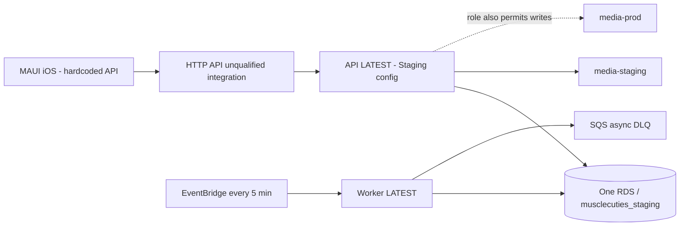

# Current-state audit

Audit date: 2026-11-04, America/Toronto. Scope: read-only repository/remote/cloud inspection and proposed documentation. During the audit phase no implementation, app build, deployment, DB connection, migration, push or cutover was executed. The owner subsequently authorized documentation adoption and GitHub branch publication; see STATUS.md for that separate scope. The owner explicitly identifies `/Users/denispetruk/RiderProjects/MuscleCuties` as the latest code. All source line references below use that checkout at `restore`, HEAD `fe350c4fd0026f18608f441fe2deb5dd3a3d5b86`, plus its uncommitted documentation overlay.

## Evidence and limits

**CONFIRMED** means observed source or successful read-only API, **INFERRED** means a reasoned implication, **UNKNOWN** means not established. Source does not prove deployment; a resource name does not prove data classification. The GitHub repo is public today. No secret values or user records were saved. [audit-evidence.json](audit-evidence.json) stores a sanitized subset of remote evidence; the source safety baseline is in the delivered bundle's `review-baseline/`.

Three bounded audit workers contributed history/product leads. All stopped at an account usage limit before final reports; the coordinator independently verified material claims below. An independent architecture consistency reviewer subsequently reviewed AGENTS and documents 00–03, identified protection/bootstrap, CI/schema-cycle and inert-resource sequencing issues, and the coordinator corrected them. Review of the remaining documents and the final correction pass is recorded in delivery verification.

| ID | Evidence (source path:line or successful command/API) | Observation and classification |
| --- | --- | --- |
| E01 | `git status --short --branch`, `git rev-parse HEAD`; captured source SHA-256 manifest | CONFIRMED: 14 modified tracked docs, one deleted tracked doc and four untracked canonical docs. Root AGENTS is already modified. No application source is dirty. Proposal is delivered as files plus a patch rather than overwriting these changes. |
| E02 | `git remote -v`, `git ls-remote --heads --tags origin/gitlab`, `git rev-list --left-right --count`, `git merge-base` | CONFIRMED: GitHub origin/main `ff3be300b5a769c1e0ccd1c5c3fa18d2d8626224`; GitLab test-flight-beta `c8ffbccb031ea0e137ce1247906a6bf770080d9f`; checkpoint `47fd713064fcf6f79e2acd894e636817952816a9`. HEAD vs GitHub is 279/65 commits; common ancestor `60f9b8d829eb7f1aeb16551cddc210e2b24737af`. HEAD vs GitLab beta is 8/8; checkpoint 54/2 reported by auditor. No advertised remote tags. Local branches include restore, resolving-conflicts, main and multiple earlier refactor/integration branches. These are candidates for disposition, not safe-to-delete branches. |
| E03 | GitHub GET `/repos/denis-petruk/MuscleCuties`, `/branches`, `/rulesets`, `/releases`, `/pulls?state=all&per_page=100` | CONFIRMED: public repo, default main, only advertised GitHub branch main, `protected:false`, rulesets empty, releases empty. Fourteen PR records; #14 Plan generation checkpoint is closed and unmerged. No evidence that remote main contains the latest Rider implementation. |
| E04 | `.gitlab-ci.yml:1–267`; `git ls-files '.github/*' '*AGENT*' '.gitmodules' '.gitattributes'` | CONFIRMED: 10 concrete CI jobs plus two templates, 7 stages; no include or cache declaration. No tracked GitHub workflows, CODEOWNERS, submodule or LFS attribute file. Existing history may still contain LFS pointers: exhaustive history scan not run. |
| E05 | `.gitlab-ci.yml:113–116`; direct file existence checks | CONFIRMED: required DatabaseSchemaCompatibilityTests, SchemaReconciliationTests and MigrationChainRehearsalTests files are all absent. CI cannot pass that stage as written. Replace obsolete assertions only with real equivalent upgrade tests; do not delete safety coverage silently. |
| E06 | `global.json:3–5`; `.gitlab-ci.yml:24,53`; `tools/deployment/verify-arm64-package.sh:4–5` | CONFIRMED: local SDK request 10.0.200/latestFeature while CI and ARM64 harness require exactly 10.0.403. Resolve deliberately and pin reproducible build/runtime/workload identities. |
| E07 | `src/*/*.csproj` ProjectReference entries; `docs/ARCHITECTURE.md:7–29` | CONFIRMED: already a modular C# monorepo: Core, UseCases, two infrastructure adapters, MAUI UI, DbMaintenance, API, separate reconciliation worker. UI project currently references Core/UseCases/Infrastructure, but architecture guards prohibit Core imports in ViewModels; do not claim zero assembly coupling. |
| E08 | `PostgresSchemaBootstrap.cs:57–88`; `PostgresSchemaDriftInspector.cs:235–245`; `DbMaintenance/Program.cs:129–168` | CONFIRMED: EnsureCreated, supplemental/security SQL, catalog seed and recorded model fingerprint. No current EF migration chain. Exact recorded/model fingerprint mismatch fails compatibility, with unsafe generic “run dbinit” guidance. INFERRED: additive old/new schema coexistence needs explicit compatibility policy and a migration baseline. dbinit can rewrite metadata/security without evolving missing model columns. |
| E09 | `DbMaintenance/Program.cs:55–58,87–90,170–173`; `session-lock-runner.sh`; `release.sh:130–153` | CONFIRMED: maintenance forbidden inside Lambda; non-loopback TLS VerifyFull required; errors avoid connection-string logging; release uses a separate advisory-lock owner. Current release wrapper remains tied to GitLab CI variables/project/branch. Locks existing in source do not prove live deployment exclusivity. |
| E10 | AWS STS GetCallerIdentity; EC2 DescribeRegions; Lambda ListFunctions and RDS DescribeDBInstances across all 17 enabled regions | CONFIRMED account 028417007003; two Lambda functions and one RDS instance, all in us-east-2. No separate Beta/Production API/DB in those returned resources. Other accounts and disabled regions are outside evidence. |
| E11 | Lambda GetFunctionConfiguration for API and worker; sanitized DB target extraction | CONFIRMED API `musclecuties-backend-api` is configured Staging, 3008 MB; worker `musclecuties-workout-reconciliation` 512 MB. Both use `musclecuties_staging` on `musclecuties-staging-db`. API login name is mc_admin, actual database privileges UNKNOWN. Worker uses separate tenant/discovery logins. No user/table reads were made. Tester-data presence and installed TestFlight endpoint versions UNKNOWN. |
| E12 | ListVersionsByFunction/ListAliases; API Gateway GetApis/GetIntegrations/GetStages | CONFIRMED API versions 1–13 exist; version 13 and LATEST digest `LM2QsLysDEaTyZUspB0tp23Bb83FKByo06pH3/QnbCg=` at observation. API integration uses unqualified function ARN, no aliases; `$default` AutoDeploy=true. Worker has only LATEST and no aliases. Published version existence does not mean traffic uses it. Local docs recording version 11 are now historical. |
| E13 | RDS DescribeDBInstances/DescribeDBSnapshots; EC2 DescribeSecurityGroups | CONFIRMED PostgreSQL 17.5/db.t4g.micro, storage encrypted, publicly accessible, backup retention 1 day, deletion protection false; latest restorable time 2026-11-04T20:06:01Z at first read. Seven available snapshots (four manual/three automated). SG permits 5432 from app SG/self and one /32 operator address, not world-open 5432. Recovery has not been rehearsed in this task. Public accessibility alone is not proof of unrestricted access. |
| E14 | IAM GetRole/GetRolePolicy/GetPolicyVersion for both runtime roles; ListOpenIDConnectProviders/GetOpenIDConnectProvider | CONFIRMED API role permits read/write/delete/version deletion in both media-staging and media-prod buckets: cross-environment write boundary is absent. Runtime trusts Lambda, not GitHub. Only registered OIDC provider returned is gitlab.com, audience sts.amazonaws.com. GitHub OIDC/deploy-role trust not established. All selected role inline/attached policies were read; organization SCPs/permissions boundaries/session policies and all other roles were not comprehensively evaluated. |
| E15 | S3 ListBuckets/GetPublicAccessBlock/GetBucketEncryption/GetBucketVersioning/GetBucketLifecycleConfiguration | CONFIRMED deploy bucket plus media-staging/media-prod; all three have all four public-access blocks, AES256 default encryption and versioning Enabled. Media lifecycle aborts incomplete uploads; deployment bucket has no lifecycle config. No media objects or contents inspected. Bucket names do not prove Production is deployed. Versioning alone is not tested deletion recovery. |
| E16 | Events ListRules/ListTargetsByRule; Lambda GetFunctionConfiguration; SQS ListQueues/GetQueueAttributes; CloudWatch DescribeAlarms | CONFIRMED worker rule enabled every 5 minutes, unqualified target, two delivery retries/one-hour max age. EventBridge target has no DLQ configuration; Lambda async DLQ is configured and queue counts 0 visible/0 in-flight at observation, SSE enabled. No CloudWatch alarms (metric/composite/log) returned in us-east-2. Empty DLQ is not proof of business success; pending-age/NeedsReview metrics unknown. |
| E17 | CloudFormation ListStacks us-east-2; repository template/tf/cdk filename inventory | CONFIRMED no stack summaries returned in us-east-2 and no established repository Terraform/CDK/CloudFormation deployment project found. UNKNOWN external IaC or other accounts; do not import/replace live resources blindly. |
| E18 | `MauiProgram.cs:109,328–336,453–454`; UI csproj:4,18–19 | CONFIRMED iOS-only, display 1.0/build 2, hardcoded current API endpoint even in Debug unless Preferences override. INFERRED local experiments can reach shared service. Cloud strength proposal client and local IWorkoutPlanner are both registered (303–308/453); duplication/equivalence is not proven solely by registration. |
| E19 | `WorkoutPlanningFlowRule.cs:21–34`; `WorkoutPlanningFlowRuleTests.cs:74–127`; `WorkoutPlanningEndpointMappings.cs:11–16,84–158`; `docs/PRODUCT_WORKFLOWS.md:7–12` | CONFIRMED first-plan automatic acceptance for a complete feasible persisted proposal is current source behavior; replacements keep acceptance. Apply carries acknowledgments. Generic preview→Apply language must not remove this exception during migration. Safety answer true/false/unanswered behavior has actual contract tests; domain changes are a separate scope. |
| E20 | `docs/design/GATE_REGISTER.md:3,13,39–59`; `docs/performance/README.md:65–103` | CONFIRMED documents report local suites/device startup and prior deployment, plus failed historic p99 6895.20ms/warm p99 5392.18ms and open remeasurement/device acceptance. Local planner requests short-circuit 409/400. UNKNOWN current authenticated planner SLO; none of these tests were rerun here. |
| E21 | `POSTGRES_BACKUP_RESTORE_DRILL_RUNBOOK.md:7–9,59–61,118–120`; current ARCHITECTURE/schema source | CONFIRMED drill runbook says it is a procedure, not completed proof, and still expects 59 applied migrations, contradicting current model-first/no-chain source. Reconcile before running it; retain historical evidence rather than treating old migration count as current clearance. |
| E22 | GitLab SSH ls-remote succeeds; unauthenticated GitLab API project/MR/issues/releases GET returns 404; GitHub connector excludes secrets/settings endpoint families; local gh unavailable | UNKNOWN GitLab variable names beyond source references, runners, hooks, protection/environments, MR/issues/releases and actual active release owner. Do not call these absent. GitHub environments, secrets metadata, Apple signing/TestFlight permissions and billing plan not audited. Public GitHub protection capabilities are documented but need actual configuration/readback. |

## Current topology

Treat this shared environment as protected pending data classification. Earlier README claims that staging accounts were purged are historical statements, not evidence that the database is disposable today. No data reset is authorized. There is no confirmed independent Beta stack; “preserve as Beta” is the target decision conditional on data/installed-client inventory.

## Existing documentation reconciliation

Retain current uncommitted AGENTS orientation, ARCHITECTURE project map, PRODUCT_WORKFLOWS, SAFETY, VERIFICATION_GATES, DESIGN, AUDIT and runbooks as canonical owners. The new set owns cross-repository cutover, environment/release design and ordered implementation only. Proposed index additions link them; no historical doc is deleted or silently marked completed.

The external `IMPLEMENTATION_PLAN_BACKEND_FIRST.md` (2026-10-31, sections 2/7/13) preserves integration provenance but assumes a checkpoint migration chain and manual release model. This plan supersedes its GitLab/platform/schema sequencing for future work; its behavior/history/hydration/measurement requirements remain useful characterization input and must be revalidated. Current source and newer explicit user decisions prevail. Notion is optional personal note taking/habits; it has no operational deployment role.

## Highest-priority conclusions

Do not run existing GitLab deployment jobs against the shared environment as an experiment. Establish a preserved Rider baseline and non-destructive history reconciliation; implement shadow CI with real schema tests; establish enforceable GitHub/IAM approval; separate Staging; establish baseline-compatible migrations; then qualify an immutable release. Recovery, authenticated performance, installed-client compatibility and device acceptance remain open.
