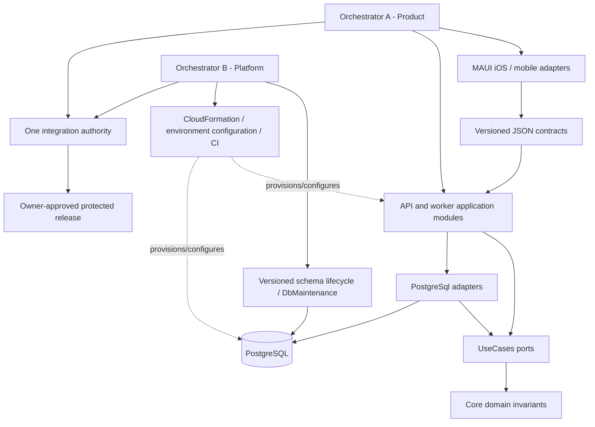

# Target architecture and release contracts

Proposed 2026-11-04, grounded in [audit E01–E22](00-current-state-audit.md). This is a design, not provisioned infrastructure. Keep the existing C# modular monorepo and paths; no microservice extraction, language rewrite or mass directory move.

## Four boundaries

| Boundary | Current paths retained | Target responsibility / restrictions |
| --- | --- | --- |
| Mobile | `src/MuscleCuties.UI`, `src/MuscleCuties.Infrastructure` | UI state/navigation/presentation and typed HTTP/encrypted cache adapters; no schema/admin credentials, no local replacement for failed authoritative planning. Introduce an anticipated `MuscleCuties.Contracts` project only after wire fixtures prove parity. |
| Backend/API/workers | `services/MuscleCuties.Server`, `services/MuscleCuties.WorkoutReconciliation`, `src/MuscleCuties.UseCases`, `src/MuscleCuties.Core` | Server transport/auth/composition; worker scheduling adapter; shared use cases and domain logic. Keep each as separately packaged deployment units in the backend release track. |
| Schema | `src/MuscleCuties.Infrastructure.PostgreSql/Persistence`, `src/MuscleCuties.DbMaintenance` | Model defines desired relational shape. A reviewed ordered migration chain defines shared evolution, including supplemental/security SQL and seed revisions. One migration owner; no app startup migration. |
| Infrastructure | anticipated `infra/cloudformation/`, current `tools/deployment/`, future `.github/workflows/` | Resource, IAM, network, storage, alarms, configuration identities and protected release automation. No domain rule changes hidden in platform PRs. |

Core remains dependency-free from outer layers. UseCases depends on Core; PostgreSql/mobile adapters implement ports. New wire contracts must not require Core/UseCases on mobile once extraction is proven. Existing UI assembly references remain until mapper/caller characterization permits removal. Modules are logical before physical project extraction.

## Environment/resource matrix

| Property | Local/Development | New isolated Staging | Stable Beta | Future Production |
| --- | --- | --- | --- | --- |
| Data | Synthetic only, disposable loopback PostgreSQL; isolated local object store/test bucket if needed | Repeatable synthetic tenants/catalog/history; no tester copies | Existing valuable tester DB/media stays in place after classification | New independently protected data plane when separately approved |
| API/worker | Local host, mocked external email/Apple/S3 | Separately deployed functions/API, worker scheduler and DLQs | Preserve current endpoint for installed clients; qualify version/alias safely | Separate functions/API/workers; no provisioning in this assignment |
| DB | Explicit ephemeral DB | Prefer separate private RDS instance | Preserve existing instance/database; improve protection through reviewed changes | Separate protected instance/account |
| S3/queues | Synthetic namespace | Dedicated buckets/queues, independent keys/roles | Existing media mapped by actual ownership, dedicated Beta role | Independent resources |
| Credentials | No Beta secrets, no implicit shared endpoint | Staging-only runtime/deploy/migrator roles and secrets | Beta-only runtime/deploy/migrator roles and secrets | Separate roles/accounts |
| Ops | No cloud access needed for ordinary tests | Alarms, tracing, restore/migration rehearsals and load fixtures | Backups, alarms, tested recovery, owner-approved release | Launch gates, capacity/privacy/recovery criteria |

**Choice:** provision new Staging in the current account first, with separate functions/API/RDS/buckets/queues/roles and no cross-write permissions. Preserve existing resources as Beta if tester data/installed builds depend on them. Same-account resource separation reduces immediate organization/Apple/domain migration complexity but has account-admin blast radius. Prefer a separate account for future Production and consider separate Beta/Staging accounts when owner capacity/budget justifies it. This is an explicit accepted-design recommendation, not an approval to spend.

A logical separate database on today's RDS is a temporary cost fallback only with a documented exception: separate login/ownership, no cross-db/role grants, independent connection identities and migration locks; shared instance failure/backup/maintenance remains. It does not meet the preferred physical isolation acceptance. Do not call aliases on a single function an isolated environment. Do not copy Beta data to ordinary Staging. Recovery clones remain protected, access-limited, time-bounded and sanitized before reusable fixtures are extracted.

Default-deny: Staging execution/deploy/migration principals cannot access Beta DB network/login, media objects, queues or secrets. Beta application role loses cross-bucket write access after proven ownership mapping. Environment manifest identifies account, region, VPC/subnets/SGs, function/alias/API IDs, DB identifier/database, secret ARNs (never values), bucket/queue ARNs, logs, expected config hash, schema range and artifact. Resource tags: Project, Environment, Owner, ManagedBy, DataClass, CostCenter. No public-production claim from a bucket suffix.

## Infrastructure as Code decision

Choose **native CloudFormation YAML** for new environment definitions, with change sets, retention/deletion policies, drift checks and explicit import review. There is no established IaC codebase in the inspected repo/account-region; native templates avoid adding a Terraform state backend or another application runtime. CDK could reduce repetition but introduces tooling/bootstrap; Terraform has cross-cloud benefits unused here. Keep this decision revisable by ADR if external IaC is discovered. Do not adopt two managers for the same resource.

Start with new Staging resources. Capture existing resources without mutation; import Beta incrementally only where supported and the no-replacement change set is verified. Stateful resources require Retain/UpdateReplacePolicy safeguards plus RDS deletion protection; retained resources still need a recovery plan. A CloudFormation rollback is not a database-data rollback. [AWS import guidance](https://docs.aws.amazon.com/AWSCloudFormation/latest/UserGuide/resource-import-new-stack.html).

## Three release tracks and infrastructure workflow

| Change | May release independently when | Required coordination |
| --- | --- | --- |
| DB expand | Old/new API and worker pass compatible-schema tests, RLS/data invariants preserved | Exclusive environment mutation lock; backup/recovery proof and owner approval for shared writes |
| Backend/API/worker | Same package verified on allowed schema; old installed-client contracts pass | API and worker event/DB compatibility matrix; deploy worker separately or as compatible pair |
| Mobile/TestFlight | Candidate endpoint supports current/previous supported clients and acceptance flows | Separate Staging/Beta binaries if compiled config/signing differs; Apple distribution approval |
| IaC protected apply | Reviewed change set/policy validation and blast radius/recovery accepted | Shared lock with all tracks; owner approval, no application deployment bundled implicitly |

Safe default sequence: additive schema → compatible API/worker → old/new client smoke → mobile rollout → contract cleanup after usage/retention evidence. Cosmetic mobile and schema-neutral API changes can run independently when their gates prove no contract impact.

Build backend/worker ZIPs once from the reviewed source/tree, hash them, validate native Linux ARM64 startup/media, store a versioned release object and attest provenance. Promote byte-identical packages to Staging and Beta with separate environment config. Published versions include environment-specific configuration, so version numbers and configuration hashes differ while ZIP digests remain the same. Route API Gateway and EventBridge to approved aliases with revision checks; publish worker versions too. Aliases are pointers, not environment isolation. [AWS alias behavior](https://docs.aws.amazon.com/lambda/latest/dg/using-aliases.html).

Use a single external per-environment mutation lease plus DB session advisory lock for schema/backend/worker compatibility windows. GitHub concurrency is supplementary and does not serialize GitLab/manual tools by itself. A release must stop/terminate if its lock-owning connection is lost. Schema and API independently gated workflows may share a lock but never implicitly run each other's changes. Disable automatic cancellation of in-flight protected mutations.

## Compatibility and schema transition

Introduce an owner-reviewed migration baseline for the *observed* existing schema; do not replay CREATE TABLE against existing data or drop/recreate Beta. Build EF migrations inside the current PostgreSql project (anticipated `Persistence/Migrations/`), with explicit SQL for security/supplement/catalog revisions. Baseline adoption is an explicit operator action that verifies the complete schema before recording history; no blanket “ignore changes” command or metadata-only bypass.

Replace strict single-model-fingerprint equality with a versioned compatibility contract: DB migration ledger/checksums, required structures/security invariants and supported app/schema intervals. Preserve a drift fingerprint for diagnostics. Test old API on expanded schema and new API on its minimum allowed schema. A forbidden/unknown drift still fails closed. The existing “run dbinit” error must become a safe diagnostic; production paths reject EnsureCreated and catalog/security restamping. [EF guidance on EnsureCreated and Migrations](https://learn.microsoft.com/en-us/ef/core/managing-schemas/ensure-created).

Freeze wire examples from Rider for registration, preferences/exclusions, injury true/false/unanswered/stale values, proposals/leases/acceptance, calendar/session/logging, hydration/measurements and auth refresh. Additive optional fields only while older clients are supported; no renaming enum/wire values or changing absent to false. Record actual TestFlight versions/installed usage before choosing a numeric minimum version or retirement window. Unsupported client handling must be owner-approved and must preserve access/export/deletion obligations.

## Orchestrator operating model

A owns product slices R01–R07 and P09/P11 product fixtures. B owns platform slices P03–P08/P10/P12–P13. Integration owns P00–P02, shared contract/migration reservations, candidate composition and promotion record. The owner remains the release approver. Only an explicitly delegated exclusive reservation permits editing a shared file. See [roadmap packages and handoff prompts](03-implementation-roadmap.md).

Approvals and evidence live in GitHub reviews/protected environments, signed release records and access-controlled artifact storage. If required reviewers are unavailable on the chosen account/tier, use owner-held signing authorization enforced outside PR-controlled code or owner-operated short-lived deployment access with no Actions Beta role. Workflow_dispatch alone is not approval. Verify current OIDC subject format, audience and actual signed claims: this public repo predates July 15, 2026, but immutable subject-claim opt-in is unknown. [GitHub AWS OIDC](https://docs.github.com/en/actions/how-tos/secure-your-work/security-harden-deployments/oidc-in-aws), [environment feature availability](https://docs.github.com/en/actions/how-tos/deploy/configure-and-manage-deployments/manage-environments).

Notion remains the owner's optional personal notes/habits workspace. CI, releases, approvals, status ledgers, credentials, artifact promotion and recovery must work with Notion entirely unavailable.
