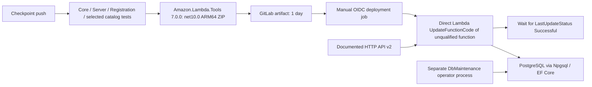
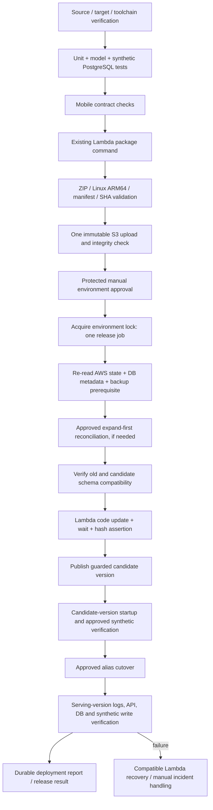

# AWS Lambda and PostgreSQL implementation plan

Audit date: 2026-10-29 (America/Toronto). Status: **planning complete; implementation and production release blocked pending the evidence and approvals below**.

Read-only follow-up after planning commit `0d5f9136`: **live database access resolved; unapplied schema changes confirmed**. The initial AWS connector denial affected its own identity. The existing local `musclecuties-operator` profile successfully accessed AWS and the exact Lambda-configured PostgreSQL database without changing permissions, networking or credentials. See the live evidence below and Appendix B.

This document is the only repository content change authorized in this phase. No backend, CI configuration, AWS resource, deployment package, database schema, migration history, or user data was changed. Four bounded read-only investigations covered CI/CD, persistence, AWS/Lambda, and reliability/security. The orchestrator reconciled their findings with GitLab UI evidence. Commands in implementation sections are specifications for later approved work, not a record of execution.

## 1. Executive summary

The current GitLab pipeline successfully tested, packaged, and manually deployed commit `ce3f62c4beaadd03c2784f6cef146381fd10e452` in pipeline [3005716440](https://gitlab.com/denis-petruk/musclecuties-testflight-beta/-/pipelines/3005716440). This is the verified operational baseline, not an arbitrary local branch. It does **not** establish database compatibility or production readiness.

The principal confirmed source defect is that deployment can replace Lambda code without checking PostgreSQL schema compatibility. `/health/ready` tests connectivity only. The existing migrations are extensive and automatic cold-start migration is deliberately forbidden. A successful control-plane update can therefore leave a healthy-looking, schema-incompatible application.

Live metadata now confirms the root cause: the Lambda-configured `musclecuties_staging` database on RDS `musclecuties-staging-db` records **31 applied migrations through `20261024200000_AddWorkoutExerciseExclusionsV010`**, while the audited backend source contains **59**, leaving **28 unapplied source migrations**. Both `app.workout_injury_logs.cleared_date` and `app.workout_session_logs.confirmed_active_seconds` are physically absent. All new objects introduced by the pending chain are absent in the scoped comparison: 11 tables, 43 ADD COLUMN effects (33 on existing tables, 10 on missing parent tables), 19 explicit indexes, two functions and two workout discovery roles. No partial application of that pending chain was found. Earlier applied migrations and existing grants were not exhaustively audited.

The live function's `CodeSha256` matches the archived GitLab deployment. The connection host matches the described RDS endpoint and the configured database matches its DBName. This confirms code was deployed ahead of database changes; missing migration files and a mere search-path problem do not explain the observed failures. The audit did not independently retrieve the original CloudWatch incident events or inspect application records.

Additional release blockers:

- Admitted web pipelines omit the push-only test job; packaging declares that dependency optional.
- There is no ZIP content validation, package/source manifest, S3 release artifact handling, version/alias rollout, authenticated smoke test, or schema gate.
- The deployment job prints the unfiltered Lambda response. The inspected job output includes an `Environment` configuration object with secret-bearing key names. No secret values are reproduced here. Restrict output and assess exposure/rotation before another release.
- AWS connector reads remain denied to `macbook-genai-dev`, but existing local operator access resolved Lambda/RDS/schema/history inspection. IAM trust, release bucket, API alias integration, complete network rules, snapshot completion and restore capability remain unverified.
- The live runtime connection uses the RDS master login `mc_admin`, which has CREATEROLE/CREATEDB and owns application tables. This violates the intended runtime/migrator separation. A separately reviewed least-privilege cutover is required; do not switch credentials blindly without authentication-function/tenant/grant validation.
- A direct-SQL-only repair leaves EF migration IDs pending; existing maintenance seed/apply commands reject pending migrations. This lifecycle conflict must be resolved before approving manual reconciliation.

Recommended direction: preserve the existing .NET 10 ARM64 packaging, operational job names, and GitLab OIDC; add mandatory tests and artifact checks; introduce an immutable S3 release identity; inspect the exact target; perform only approved expand-first reconciliation before incompatible code cutover; verify actual runtime/database behavior; retain auditable recovery evidence. Do not rebuild or drop the database, reset history, add a new migration framework, or migrate during Lambda initialization.

## 2. Git baseline and isolation

| Item | Verified value/evidence |
| --- | --- |
| Remote project | `git@gitlab.com:denis-petruk/musclecuties-testflight-beta.git`, remote name `gitlab` |
| Requested source branch | `codex/plan-generation-checkpoint` |
| Freshly fetched source commit | `ce3f62c4beaadd03c2784f6cef146381fd10e452` |
| Source tree | `ec4f64ba64e40ca290cead865582c736d0694da1` |
| Baseline selection | GitLab branch page and pipeline 3005716440 identify this SHA; all four jobs were passed, including deployment |
| Verify/package/deploy/mobile jobs | [17588691560](https://gitlab.com/denis-petruk/musclecuties-testflight-beta/-/jobs/17588691560), [17588691561](https://gitlab.com/denis-petruk/musclecuties-testflight-beta/-/jobs/17588691561), [17588691562](https://gitlab.com/denis-petruk/musclecuties-testflight-beta/-/jobs/17588691562), [17588691563](https://gitlab.com/denis-petruk/musclecuties-testflight-beta/-/jobs/17588691563) |
| Pipeline timing | Created 2026-10-29 16:02:05 EDT; finished 16:09:15 EDT |
| Default branch | `test-flight-beta`, `fb954b4c45ff1b2abff30f1e8f5194370f85e91b`; default status does not make it the newer deployment baseline |
| Target branch | `infra/aws-lambda-postgres` |
| Isolated worktree | `/Users/denispetruk/Documents/ChatGPT/MuscleCuties/aws-lambda-postgres` |
| Initial branch verification | HEAD equaled the full baseline SHA; HEAD tree equaled the source tree; `git diff --name-status <baseline>` was empty; clean branch status |
| Original checkout preserved | `/Users/denispetruk/RiderProjects/MuscleCuties`, local HEAD `276bbd31`, ahead of the selected GitLab baseline by one local commit including UI/test edits; uncommitted `ROADMAP.md` and `STATUS.md` retained |

Actions completed: inspected `AGENTS.md`, `docs/README.md`, indexed deployment documentation, source, Git history, and CI; fetched `gitlab --prune`; created the new branch from the exact SHA with `git worktree add -b infra/aws-lambda-postgres ... ce3f62c4beaadd03c2784f6cef146381fd10e452`. No merge, cherry-pick, conflict resolution, or history rewrite was performed. The explicit plan-only constraint takes precedence over AGENTS.md's general instruction to update ROADMAP/STATUS; those files are intentionally excluded from this commit.

### Safe planning-branch publication

`.gitlab-ci.yml:1–6` rejects push and web pipelines on `infra/aws-lambda-postgres`; there are no includes. Live project CI settings show the configuration path unset/default `.gitlab-ci.yml`, Auto DevOps disabled, and zero pipeline trigger tokens. The branch is new and no merge request is being created in this phase. Publish only this documentation commit with `git push -o ci.skip -o integrations.skip_ci gitlab HEAD:refs/heads/infra/aws-lambda-postgres`; never push to the checkpoint or default branch. These options add protection against branch CI and supported external CI integrations; they do not substitute for checking workflow rules. Re-fetch/check the remote branch immediately before publication, do not overwrite an unexpected existing ref, and verify the resulting SHA and lack of running deployment afterward. If the configuration or branch state changes, retain the committed plan locally instead. See [GitLab push options](https://docs.gitlab.com/topics/git/commit/) and [pipeline skipping limitations](https://docs.gitlab.com/ci/pipelines/).

## 3. Evidence register and current architecture

Evidence labels used below:

- **S — source verified:** inspected at the baseline SHA.
- **G — GitLab observed:** authenticated GitLab UI, including archived job output/settings.
- **H — historical/local notes:** documentation or preserved uncommitted owner notes; not a new live AWS/SQL finding.
- **L — live read-only verified:** follow-up AWS SDK calls using the existing operator profile and PostgreSQL catalog/history queries under an explicitly read-only transaction.
- **U — unknown:** inaccessible or not inspected; must not be promoted to verified by inference.

### Current flow



Web pipelines on the two allowed branches can start at packaging without B. There is no release-bucket upload in the current CI flow. The configured S3 bucket is application photo media, not evidence of a deployment bucket.

### Backend and persistence

- `services/MuscleCuties.Server/Program.cs:4–7`: ASP.NET Core executable using `AddAWSLambdaHosting(LambdaEventSource.HttpApi)`.
- `services/MuscleCuties.Server/MuscleCuties.Server.csproj:3–17`: `net10.0`, assembly `MuscleCuties.Server`, invariant globalization, Lambda hosting package `2.2.1`, JWT package `10.0.3`; project references PostgreSql and UseCases. NU1202/NU1701 are suppressed and fallback frameworks are configured; validate Linux dependency compatibility rather than treating warning suppression as proof.
- `src/MuscleCuties.Infrastructure.PostgreSql/MuscleCuties.Infrastructure.PostgreSql.csproj:18–22`: existing EF Core Design/Npgsql provider `10.0.3`. This is already an ORM/migration-based application.
- `Persistence/PostgresDbContext.cs:89–108` under that project: `app`, `catalog`, and `ops` schemas. Model configuration explicitly qualifies schema/table names, so `search_path` alone cannot repair an absent `app` column.
- `services/MuscleCuties.Server/ApiApplication.cs:114–132`: connection and authentication signing configuration are startup dependencies. `LambdaHostingConfiguration.cs:31–95` enforces VerifyFull TLS, bounded pool defaults max 5/min 0, reset-on-close and no cold-start migration. Names/comments mention RDS Proxy; existence is unverified.
- `PostgreSqlServiceCollectionExtensions.cs:9–51` in `Persistence`: pooled context, connection/command timeouts, transient retries and certificate discovery. Effective Lambda settings override some base connection settings; inspect effective sanitized configuration.
- `PostgresTenantContext.cs:21–29`: transaction-local `app.user_id`; preserve RLS and connection reset behavior.
- `ApiApplication.cs:871–886`: readiness calls `CanConnectAsync`; it does not validate the schema or migration status.
- `src/MuscleCuties.DbMaintenance/Program.cs:115–140`: read-only `migration-status`; separate mutating `migrate --confirm` runs role bootstrap then `MigrateAsync`; seed/apply refuses pending EF migrations. The tool refuses Lambda execution (:45–49). Error handling currently prints `exception.Message` (:158–162), contrary to its own secret-safety comment; redact before CI automation.

### CI traced end to end

The complete configuration is `.gitlab-ci.yml:1–87`; no included YAML, child pipeline, or deployment script is referenced.

| Job | Actual behavior | Gaps |
| --- | --- | --- |
| `verify_plan_generation` (:19–30) | Push on checkpoint only; SDK `10.0.403`, installs `libfontconfig1`; Release tests Core, Server, Registration, and Integration filtered to `ReviewedExerciseCatalogV020ImportTests` | Restore/build implicit; no full PostgreSQL fixture or deployment check |
| `package_staging_lambda` (:32–48) | SDK `10.0.403`, zip, Lambda Tools `7.0.0`; package command in section 11; ZIP artifact expires in one day | `verify_plan_generation` need is `optional:true`; no archive/integrity/source gate |
| `deploy_staging_lambda` (:50–76) | Manual; AWS CLI image `latest`; consumes package; GitLab ID token audience `sts.amazonaws.com`; STS web-identity assumption for 3600 s; direct `--zip-file` update; waiter and final status test | No explicit blocking `allow_failure:false`, environment, resource lock, SHA comparison, DB check, runtime check, publish/alias/rollback |
| `verify_mobile_contracts` (:78–87) | Checkpoint push only; depends on backend verify, not deployment | Deployment does not wait for this contract check |

Current workflow admits checkpoint push/web and default-branch web only. OIDC is already implemented; introducing static keys is unnecessary. A green pipeline alone is not proof the optional manual deploy ran, but **this baseline's deployment job is explicitly passed in G evidence**.

### GitLab protection evidence

Live repository settings: both checkpoint and `test-flight-beta` are protected, merge/push limited to Maintainers, force push off; no protected tags. CI settings: `AWS_ROLE_ARN` and `AWS_LAMBDA_FUNCTION_NAME` are protected and masked; auto-cancel redundant pipelines, separate protected caches, and prevent-outdated-deployments enabled; rollback job retries allowed; manually supplied pipeline variables disabled; protected resources allowed for eligible protected-ref MR pipelines. Current YAML declares no environment, so the environment deployment-safety setting alone is insufficient. Protected-environment approvals/tier entitlement were not verified. Do not broaden protected-resource access to the new planning branch.

### AWS evidence: deployment-time records versus live resources

Job 17588691562 checked out `ce3f62c4` and recorded this UpdateFunctionCode response at 20:09:06 UTC, then completed its waiter/status check and succeeded at 20:09:13 UTC:

| Safe field | Archived job value (G), not a current AWS re-query |
| --- | --- |
| Runtime / architecture / package | `dotnet10` / `arm64` / `Zip` |
| Handler | `MuscleCuties.Server` |
| Code size / CodeSha256 | 9,077,342 bytes / `gS2dwDP9vlJ+p9xMwqEZkvlfL0tCOPKouzp2SOIf508=` |
| LastModified / RevisionId | `2026-10-29T20:09:05.000+0000` / `03cbe499-4273-4ffe-b5e9-702b07bbe828` |
| Memory / timeout | 1024 MB / **27 seconds**, versus source defaults 29 seconds |
| VPC / subnets / security group | `vpc-02c2c07f0bf07f145`; `subnet-0ce86904005e7726f`, `subnet-0b5ce78ce2660d88b`; `sg-03fbb100b48b6e76b` |
| IPv6 / logging | dual-stack enabled; Text logging; masked `/aws/lambda/...` log group |
| Immediate state | `State=Active`, `LastUpdateStatus=InProgress` in update response; subsequent explicit status assertion succeeded |

Function and role names are masked in that job. Separate H operator notes identify `musclecuties-backend-api` and API `y2ejsgrc6l` in `us-east-2`; do not equate a masked CI target with that function until the allowlisted ARN is checked securely. The job recorded environment key names for database connection, JWT, email keys, Resend, Apple credentials, storage and Lambda pooling; values were not copied into this audit.

The initial AWS MCP identity was account `028417007003`, IAM user `macbook-genai-dev`; relevant Lambda/API/RDS/S3/Logs reads were denied. This was an access-path limitation, not proof no authorized database access existed. The follow-up used the already-authenticated `musclecuties-operator` SDK profile, identifying `arn:aws:iam::028417007003:user/denis.operator`. No new sign-in, role grant, network rule, password or credential configuration was required. Connection values remained in process memory; no passwords or application rows were output or saved.

Live GetFunctionConfiguration now verifies function `arn:aws:lambda:us-east-2:028417007003:function:musclecuties-backend-api`, runtime `dotnet10`, ARM64, handler `MuscleCuties.Server`, 1024 MB, 27-second timeout, Active/Successful, execution role `musclecuties-backend-api-role-oot9kwhk`, and the same VPC/subnet/SG IDs recorded above. Current RevisionId is `fd813561-e054-4973-a11a-013b7b3f25a6`; LastModified remains `2026-10-29T20:09:05.000+0000`; code hash remains `gS2dwDP9vlJ+p9xMwqEZkvlfL0tCOPKouzp2SOIf508=`. A changed RevisionId alone is not a different artifact.

Live RDS DescribeDBInstances identifies `musclecuties-staging-db`, PostgreSQL **17.5**, available, encrypted storage, DBName `musclecuties_staging`, port 5432, the same VPC, SG `sg-0921332c15883d1d9`, `PubliclyAccessible=true`, and IAM DB authentication disabled. Backup retention is **one day**; latest restorable time observed was `2026-10-29T20:56:05Z`. This is backup metadata, not evidence of a successful restore. Public accessibility does not establish open security-group ingress; those rules remain uninspected.

The Lambda-configured host directly equals that RDS endpoint, confirming direct RDS connectivity for this function rather than a Proxy endpoint. The metadata connection used AWS's public CA bundle, hostname verification (`verify-full`) and TLSv1.3 (`TLS_AES_256_GCM_SHA384`, 256 bits). The session had `default_transaction_read_only=on`, explicit `REPEATABLE READ READ ONLY`, 10-second statement and 1-second lock timeouts, and ended with ROLLBACK. The query confirmed `transaction_read_only=on`. Only catalog/role/migration-history metadata was read: 62 tables, 594 columns, 204 constraints, 236 valid/ready indexes, 41 policies, four function metadata records and nine relevant role records. API/alias integration, full IAM policies, release bucket, network rules and completed snapshot/restore evidence remain **U**.

Reconciled documentation contradictions:

- `docs/OPERATOR_ACTION_MANUAL.md:31,37` implies deployment on push. Current YAML is manual since commit `4e1f57f1`; preserve the functioning manual behavior.
- Lambda defaults description claims RDS Proxy; operator guide :45 says direct RDS/no Proxy. Live configured host now confirms this function connects directly to the described RDS instance. Do not add a Proxy merely to match a comment.
- Historical notes about a duplicate `planning_slot_id` addition are stale: `20261027060000` owns it; `20261027235000` now explicitly leaves it alone. Deployed older variants remain a history question.
- `docs/ci-injury-clock-20261028.md` records `CS7036` at old `e305858a` from missing `TimeProvider`; this is historical, not a failure of the newly observed passed pipeline. The current pipeline list/failure traces were not exhaustively audited.

## 4. Database gap matrix

The expected schema is the current model **plus** source migrations for RLS/grants/functions/data conversions that a model snapshot alone cannot represent. There are **59 migration classes** at this baseline. Exclude only `*.Designer.cs` and the exact `PostgresDbContextModelSnapshot.cs` when inventorying; a valid migration is named `AddWorkoutSessionPrescriptionSnapshot`.

The matrix now incorporates **L** catalog and migration-history evidence. All post-October-24 object families below were checked against the collected physical catalog; their required new objects are absent. Existing pre-October-24 objects/security/data were not comprehensively proven correct. All paths in the defining-source column are under `src/MuscleCuties.Infrastructure.PostgreSql/Persistence/Migrations/`. Appendix B enumerates exact live absences.

| Expected object/definition | Actual accessible evidence | Severity/confidence | Required correction after proof |
| --- | --- | --- | --- |
| `app.workout_injury_logs.cleared_date`, `date NULL` | **L physically absent**; defining ID absent from ledger; S `20261026220000_AddWorkoutSafetySuppression.cs:16`; model `Models/App/AppRepoModels.cs:274` | Critical; L + S | Reconcile approved missing column with complete chain; no inferred clearance-date backfill |
| `app.workout_session_logs.confirmed_active_seconds`, `integer NOT NULL DEFAULT 0` | **L physically absent**; defining ID absent from ledger; S `20261027020000_AddWorkoutActiveIntervals.cs:12` | Critical; L + S | Reconcile complete active-interval family, not just first failing selection |
| Same table: `timing_interval_id uuid NULL`, started/last-confirmed UTC timestamps nullable, `timing_interval_confirmed_seconds integer NOT NULL DEFAULT 0` | **L all absent**; S same migration :13–16 | Critical/high; L + S | Use exact timestamptz mapping; zero means existing unknown active time, not reconstructed duration |
| Safety family on `app.workout_days`: `is_removed_by_safety bool NOT NULL DEFAULT false`, nullable `safety_injury_id uuid`, `safety_activity_type_id integer`, `activity_type_id integer`; session planned day UUID, timezone text/version bigint/date; planning-state `safety_regeneration_pending bool NOT NULL DEFAULT false` | S `20261026220000:12–21`; **L fields absent; planning-state parent absent** | High; L + S | Parent planning-state table first; preserve null/false semantics and tenant boundaries |
| `app.workout_account_planning_states`, `app.workout_completion_day_credits`, owner/date indexes and RLS | S `20261026200000:13–49`; **L both tables/indexes/policies absent** | Critical/high; L + S | Parent keys/tables before dependents; **no fabricated historical completion-credit backfill** (:51) |
| Proposal lease ID/fence/expiry; account `answer_version`, `answers_json` JSONB | S `20261026190000_AddWorkoutProposalLeases`, `20261026210000_AddWorkoutActivityAnswers`, `20261027040000_AlignWorkoutAnswersJsonType`; **L lease fields and planning-state parent absent** | High; L + S | No current planning-state answers exist to convert on this observed target; preserve safe conversion handling for interrupted/other environments |
| Session origin/lineage, `planned_prescription_snapshot_json jsonb NULL`, day order, unplanned-completion provenance | S `20261027010000`, `27030000`, `27070000`, `27080000`; **L all added fields absent** | High; L + S | Preserve provenance; deterministic defaults only, do not invent clinical/session history |
| Injury episodes/prescriptions, active-episode partial unique index, tenant RLS; restoration metadata, episode links and composite owner FKs | S `20261027050000_AddWorkoutInjuryProvenance`, `20261027230000_AddWorkoutInjuryExerciseProvenance`, `20261027233000_AddWorkoutInjuryEpisodes`, `20261028000000_GrantWorkoutInjuryEpisodeAccess`; **L tables/fields/indexes/policies absent** | Critical/high; L + S | Reconcile new parents before links/security; no existing episode rows to backfill without provenance; no record dumps |
| Exercise `planning_slot_id` / origin lineage; template ID/version/session index | S `20261027060000_AddWorkoutExercisePlanningLineage:11–14`, `20261027235000_AddWorkoutPrescriptionSlotIdentity:12–15`; **L all absent** | High; L + S | No duplicate-source fix needed; create once in correct dependency order |
| Restricted reconciliation-discovery roles/function/policy and singleton cursor | S `20261027231000_AddWorkoutReconciliationDiscovery:11–55`, `27232000_AddWorkoutReconciliationCursor`; **L roles/function/policy/cursor table absent** | High/security; L + S | Establish restricted ownership/execute grants and singleton initialization without enabling scheduler |
| Reviewed template volume floors, catalog lock function and owner | S `20261026230000_LockWorkoutPlanningCatalog`, `27234000_AddReviewedTemplateVolumeFloors`, `27234500_OwnReviewedTemplateVolumeFloors`, `28000000_RemoveTemplateFloorAttributionRequirement`; **L table and lock function absent** | High/security; L + S | Create final reviewed table/function/ownership/grants; physical repair must account for later attribution relaxation and untouched EF history |
| Canonical deload state, HIIT challenge capture, JSON activity occurrence prescriptions, strength-style offers, omitted injury slots, cycle-readiness occurrences/state | S `20261028010000`, `28100000`, `28110000`, `28120000`, `28140000`, `28190000`; **L all added fields/new tables/indexes/policies absent** | High; L + S | Include composite tenant keys/FKs, RLS, grants and final cycle-discovery predicate |
| Earlier registration/catalog/workout requirements and seed provenance | S migrations `20261017*`–`20261024200000`; **L all 31 IDs recorded**, but their complete effects/seed data were not audited | High; history L, full baseline parity U | Rehearse from observed 31-ID starting shape and compare earlier security/catalog definitions before release |
| Migration ledger and physical catalog agreement | **L 31 applied, 28 source IDs absent, no unknown applied IDs; all pending-chain object effects absent in scoped comparison** | Confirmed unapplied chain; L + S | Review complete 28-change reconciliation, preserve history, no blanket run or fabricated ledger rows |
| Runtime DB selection and privilege parity | **L exact Lambda connection targets described RDS DB; runtime uses master `mc_admin`, CREATEROLE/CREATEDB/table owner** | Target verified; privilege separation high risk, L | Separately design/test least-privilege runtime login and grants; do not replace it blindly or assume RLS behavior proven |

Full IDs matter: two `20261023160000_*` and two `20261028000000_*` classes have distinct names. Timestamp prefixes alone are not duplicate IDs.

## 5. Root-cause analysis

| Candidate cause | Conclusion and evidence |
| --- | --- |
| Code released without a schema compatibility gate | **Confirmed S**, and G demonstrates a successful deployment using that path. Current CI never runs schema status/reconciliation or authenticated route checks. |
| Backend expects columns absent from its connected DB | **Confirmed L + S** for both incident columns and the complete pending-chain object scope. Dashboard's full session entity selection can fail before deciding whether a session exists. |
| Missing migration files | **Not supported.** Both reported columns and 59 migration classes exist in source. |
| Unapplied changes / environment drift | **Confirmed L + S:** database history ends at the October 24 ID; all 28 later source IDs and their new-object effects are absent. No partial application of this pending chain found; earlier baseline drift remains unassessed. |
| Wrong database/schema/role | The audited connection is **the exact live Lambda target**, directly matching the RDS endpoint/DBName. Objects are physically absent from explicit `app`/`catalog` namespaces, not merely hidden by information_schema grants. Owner intent for staging versus production remains a separate approval. Runtime master-account use is an additional confirmed security concern. |
| False-positive readiness | **Confirmed S.** Connectivity can pass without required columns/constraints/functions. |
| Source duplicate planning column | **Resolved in baseline S.** Do not modify old migrations based on stale documentation. |
| Obsolete initializer failed to run | Runtime initialization intentionally does not migrate. This is an operational sequencing issue, not justification to enable initialization DDL. |
| Incomplete EF model/snapshot or deployment artifact mismatch | Live function hash **matches the archived GitLab build/deploy hash**, resolving deployed-byte identity for this diagnosis. ZIP content/source model snapshot parity and all earlier schema effects were not independently validated. |

The verified diagnosis is **application code deployed ahead of 28 unapplied database changes, enabled by a pipeline with no schema compatibility gate**. The ledger and physical catalog agree for the pending-chain scope; this is not an absent-files or search-path-only issue. The exact reviewed repair remains an approval/rehearsal task: neither “run everything blindly” nor “add just two columns” is safe. No schema changes were executed.

## 6. Target architecture and deployment sequence

Retain existing job names, .NET packaging and OIDC. Proposed stages: `source_verify → backend_verify → client_verify → backend_package → artifact_validate → artifact_upload → backend_deploy → deployment_report`. Existing stage names remain; client contracts move ahead of packaging. New source/artifact/report stages are additive.



The environment lock covers **DB preflight through runtime verification/recovery**, not merely each individual job. Separate jobs sharing a `resource_group` can still interleave releases between stages. Keep these operations inside one `deploy_staging_lambda`/`deploy_production_lambda` job or use a parent lock held through a child pipeline; the minimal proposal uses one job and one orchestrating script. Lock identity must follow actual shared function/database resources: if staging and production overlap, both jobs use the same resource group and database advisory-lock identity rather than separate label-based locks. Hold the DB session lock through rollout, runtime verification and recovery as well. Upload is outside the lock because its artifact identity is immutable and nonactivating. For an unqualified API integration, code update activates traffic before candidate verification; the controlled-maintenance exception in section 10 applies until a separately approved alias cutover exists.

DB ordering is based on compatibility:

1. Inspect both currently serving and candidate requirements. Apply only additive, backward-compatible expansion before rollout, then verify both versions against it.
2. If old code is already failing because expansion is missing, repair the proven requirements under a separately approved incident window; no new rollout until compatibility passes.
3. For type conversions, required backfills, destructive column removal or semantic changes, stage compatible additions/dual handling or use an approved maintenance window. Do not call the old migration chain blindly.
4. Cut over application traffic only after the candidate requirements pass. Defer contract/cleanup changes to a later separately approved release after rollback horizon and client compatibility are proven.

Environment policy: preserve existing checkpoint staging entry point only after proving its target is isolated. Proposed production entry point is a reviewed, current commit on existing protected `test-flight-beta`, web/manual only. That branch currently lags the selected baseline; no production release from it until the intended merge and validation are separately approved. If the supposed staging resource serves real beta users or shares production DB, treat it as production immediately and require equivalent controls. Names/public endpoints alone do not prove separation.

## 7. File-by-file implementation change list

All entries below are **future proposed work**; only this document exists as a change in this phase. New paths are design decisions, not claims of existing tooling.

| Exact path | Proposed change and traceability |
| --- | --- |
| `.gitlab-ci.yml` | Preserve four existing jobs; unify allowed validation rules, remove optional test bypass, move contracts before package, add source/model/DB tests, validate/upload artifacts, protected environment jobs, nonoptional manual gates, serialization and reports. Addresses CI/web bypass and release gaps. |
| `global.json` | Pin SDK to the validated CI `10.0.403`, disallow prerelease and bound roll-forward after checking local/iOS impact; current no-version/latestMajor selection is irreproducible. Do not mix unrelated MAUI changes. |
| `services/MuscleCuties.Server/MuscleCuties.Server.csproj` | Supply commit/build metadata during publish; verify ARM64/native assets and current fallback/warning suppressions. Remove suppressions only if demonstrated incompatible and separately scoped. |
| `services/MuscleCuties.Server/aws-lambda-tools-defaults.json` | Correct descriptive Proxy claim after live inspection; reconcile documented 29s versus recorded 27s deliberately. Do not silently update live configuration along with code. |
| `services/MuscleCuties.Server/ApiApplication.cs` | Optionally expose nonsecret build SHA via internal release diagnostics and extend readiness to bounded schema compatibility. Preserve stable client failure codes; avoid metadata/schema details in public responses. Pipeline preflight remains mandatory even if runtime readiness is extended. |
| `services/MuscleCuties.Server/LambdaHostingConfiguration.cs` | Retain cold-start-DDL prohibition/TLS/pooling; change only if focused configuration tests expose a defect. Names are not evidence of Proxy deployment. |
| `src/MuscleCuties.Infrastructure.PostgreSql/Persistence/DatabaseSchemaCompatibility.cs` (new) | Bounded read-only catalog evaluator, source requirement manifest, explicit app-role privilege checks; never apply DDL. Single authority shared by maintenance/preflight and optional readiness. |
| `src/MuscleCuties.DbMaintenance/Program.cs` | Add explicit `schema-preflight`/`schema-verify` commands and, only for approved SQL mode, `schema-reconcile` with hash/target/approval checks. Redact provider exception messages before running tool in CI. Resolve pending-history behavior explicitly; retain existing command semantics unless reviewed. |
| `src/MuscleCuties.DbMaintenance/Schema/SchemaRequirements.json` (new) | Versioned expected catalog/type/default/nullability/key/index/RLS/grant/function requirements and compatibility range, derived from tested source/reference DB, not a new migration framework. |
| `src/MuscleCuties.DbMaintenance/Schema/ApprovedReconciliation.json` (new, conditional) | Target fingerprint, reviewed operations/dependencies, pre/postconditions, SQL checksums, transaction classification and history-mode decision. Create only after live metadata/rehearsal. No production DDL is generated in this plan. |
| `src/MuscleCuties.DbMaintenance/Schema/Reconciliation/` (new, conditional) | Minimal explicit SQL files for proven differences, separately reviewed after audit access. Exact filenames and DDL cannot honestly be finalized without catalog evidence. No blanket generated migration bundle or unconditional catch-up. |
| `tools/deployment/validate-package.sh` (new) | Fail on bad ZIP paths/root/files/config/secret leakage; call Linux ARM64 harness; produce SHA/content manifest. Shell is CI tooling; production code remains C#. |
| `tools/deployment/upload-artifact.sh` (new) | Upload-once immutable S3 key, verify hash/version, narrow AWS output; preserve same object for staging→production promotion. |
| `tools/deployment/release.sh` (new) | Single serialized state machine: target guards, metadata, DB gates, approved reconciliation, update/wait/publish/alias, smoke, safe recovery and durable sanitized report. Preserve known-good state on every partial failure. |
| `tools/deployment/verify-runtime.sh` (new) | Verify serving version/code SHA, bounded logs and essential API checks with approved synthetic identity. No raw response bodies, Authorization headers or user records in artifacts. |
| `tools/deployment/Dockerfile` (new) | Pinned .NET SDK 10.0.403 plus pinned AWS CLI and archive utilities, verified downloads/digests. This solves the current AWS-CLI-only deployment image's lack of .NET for maintenance. Build/review image before use; pin its final digest in CI. Use a separate approved ARM64 harness for package execution. |
| `tests/MuscleCuties.Server.Tests/LambdaHostingConfigurationTests.cs` (new) | Missing settings, invalid pools/timeouts/TLS, certificate handling, cold-start migration rejection. |
| `tests/MuscleCuties.Registration.Integration.Tests/DatabaseSchemaCompatibilityTests.cs` (new) | Intentionally missing reported columns, wrong schema/types/defaults/RLS/grants and history mismatch in synthetic disposable fixtures fail preflight. |
| `tests/MuscleCuties.Registration.Integration.Tests/SchemaReconciliationTests.cs` (new, conditional) | Apply twice, wrong starting shape, rollback on injected transactional failure, interrupted nontransactional-index detection, lock contention and resume. |
| `tests/MuscleCuties.Registration.Integration.Tests/DisposableWorkoutDatabaseSetupTests.cs` | Make CI setup opt-in execution observable and fail setup gate if it did not execute; preserve local host/name safeguards. |
| `tests/MuscleCuties.Deployment.Tests/MuscleCuties.Deployment.Tests.csproj` (new) | Fixture ZIP and fake AWS/process tests for corrupt archive, missing dependency, stale SHA, revision race, failed smoke, report failure and retry idempotency. Do not write trivial tests that merely duplicate shell text. |
| `docs/OPERATOR_ACTION_MANUAL.md`, `docs/README.md` | Correct push/manual description, link approved runbooks, exact environment/role ownership, history-mode constraints and recovery evidence. |
| `docs/infra/AWS_LAMBDA_POSTGRES_IMPLEMENTATION_PLAN.md` | Update approved decisions and evidence as future phases close; this phase changes only this file. |

Existing migration classes and model snapshot are evidence, **not proposed edit targets**. Do not rewrite applied historical migrations. Existing same-prefix migration names remain intact. No application feature or mobile UI implementation is included.

## 8. In-place database strategy

### Feasibility and required history decision

An in-place update without **new EF migrations** and without rebuilding the DB is viable. Explicit `ALTER TABLE`/DDL is still a schema migration in the general sense. Safe SQL cannot be finalized until physical catalog, history, active code and data-compatibility preconditions are observed.

Two minimal paths require an explicit owner decision:

| Path | Conditions and consequences |
| --- | --- |
| **Preferred low-change alternative: reviewed existing EF chain** | Uses already committed migrations, creates no new EF migration/framework, preserves history naturally. Only viable after complete chain rehearsal on the actual starting shape, confirmation no manual drift, and review of destructive/data conversion steps. Existing `migrate --confirm` also bootstraps roles; account for those privileges/changes. Not approved or executed here. |
| **Owner-preferred explicit SQL reconciliation** | Apply narrowly reviewed, idempotent changes for actual gaps; leave EF history untouched. Add physical compatibility evidence and a separately approved maintenance-mode policy. Existing `seed`/catalog apply cannot proceed while IDs remain pending, and generic `migrate` must be prohibited for this manually reconciled environment until an approved ledger-convergence strategy exists. Do not falsely mark incomplete EF migrations applied. |

If the owner requires both unchanged maintenance behavior and absolutely no EF execution/history handling, a durable SQL-only repair is **not yet viable**: the seed gate and future migration collisions are concrete blockers. A compatibility manifest is an explicit catalog contract/audit artifact, not permission to introduce a new migration framework or silently bypass history. The smallest alternative is review/use of the existing chain or an explicitly approved narrow maintenance-policy change.

### Read-only discovery and preconditions

Run from a protected runner with private database network access and read-only metadata credentials first. Secrets enter through scoped process configuration, never command arguments, YAML literals, logs or report JSON. Use the same effective host/database/TLS identity as the Lambda, but evaluate app-role permissions separately from catalog-owner access. Do not set `AWS_LAMBDA_FUNCTION_NAME` in the maintenance process.

Existing command (reads status only, not sufficient as a compatibility gate):

```sh
dotnet run --project src/MuscleCuties.DbMaintenance/MuscleCuties.DbMaintenance.csproj --configuration Release -- migration-status
```

It requires `ConnectionStrings__PostgreSql`; EF design-time tooling instead uses `MUSCLECUTIES_POSTGRESQL_MIGRATIONS_CONNECTION`. Do not interchange these names. `migration-status` returns exit 0 even with pending IDs: the new gate must parse Applied/Pending and compare physical requirements. Its current exception logging must be corrected before use in shared CI logs.

Proposed new command contract (to implement/test in Phase 3, **not available today**): `schema-preflight <requirements-path> <requirements-sha256>` and `schema-verify <requirements-path> <requirements-sha256>` are read-only and exit nonzero on incompatible/unknown target, catalog or history policy. Conditional `schema-reconcile <approved-manifest-path> <manifest-sha256> --confirm` is mutating, accepts only a separately approved manifest whose target fingerprint and history mode match, and never accepts arbitrary SQL/connection strings on the command line. The manifest names fixed repository SQL paths and hashes, dependencies and per-step transaction classification. Approval is enforced by protected release controls, not merely the `--confirm` flag. Reports contain stable failure codes and safe metadata only.

Exact proposed invocations once implemented use `dotnet run --project src/MuscleCuties.DbMaintenance/MuscleCuties.DbMaintenance.csproj --configuration Release -- schema-preflight src/MuscleCuties.DbMaintenance/Schema/SchemaRequirements.json "$SCHEMA_REQUIREMENTS_SHA256"`, the same prefix with `schema-verify`, and, only when authorized, `schema-reconcile src/MuscleCuties.DbMaintenance/Schema/ApprovedReconciliation.json "$APPROVED_RECONCILIATION_SHA256" --confirm`. These hash values come from the approved immutable build manifest; they are not unvalidated web-pipeline variables. Keep the physical requirements contract canonical; any runtime copy must be a build-verified copy of the same hash rather than a separately edited second definition.

Read-only SQL metadata collection must use a read-only transaction with bounded statement/lock timeouts, and return only metadata/counts. Initial queries include:

```sql
SELECT current_database(), current_user, current_schema(),
       current_setting('server_version'), current_setting('search_path');
SELECT table_schema, table_name, column_name, data_type, udt_name,
       is_nullable, column_default
FROM information_schema.columns
WHERE table_schema IN ('app', 'catalog', 'ops')
ORDER BY table_schema, table_name, ordinal_position;
SELECT schemaname, tablename, indexname, indexdef
FROM pg_indexes WHERE schemaname IN ('app', 'catalog', 'ops')
ORDER BY schemaname, tablename, indexname;
SELECT schemaname, tablename, policyname, roles, cmd, qual, with_check
FROM pg_policies WHERE schemaname IN ('app', 'catalog', 'ops')
ORDER BY schemaname, tablename, policyname;
```

Also collect `pg_constraint` definitions/validation and composite keys; `pg_class` RLS/force-RLS, owner and approximate sizes; `pg_index` validity; function signatures/owner/security-definer/search_path/execute ACL; schema/table/sequence privileges; relevant role memberships; migration-history table location/full IDs; database/role grants. Use catalog-based checks where information_schema hides inaccessible objects. Inspect no health records. Data preconditions return aggregate invalid-JSON/null/duplicate/orphan counts only, through reviewed read-only checks, with RLS-aware coverage. Avoid EXPLAIN ANALYZE or arbitrary function calls that could mutate data. Compare history and metadata against both candidate and a trusted copy/manifest of the serving package.

Before any future DDL: approve exact target fingerprint, review complete operations/hash, prove old/new compatibility, ensure no unreviewed pending chain, validate table size/lock budget/disk headroom, confirm app-role least privilege, and have a tested restore procedure. Re-read under the release lock immediately before application; stale preflight results are not sufficient.

### Proposed operations, dependency order and safeguards

These are conditional operation descriptions, not production SQL:

1. **Parent objects/security baseline:** validate foundational schemas, owner/user keys, planning-state tables and catalog authority; create only proven missing parent objects from the audited definitions. Establish restrictive RLS/grants before application access.
2. **Additive fields:** reconcile the exact injury `cleared_date` and complete active-interval family in section 4, plus all other required proven gaps. Existing matching objects are a verified no-op; incompatible existing objects cause failure, not a silent skip. Nullable dates/UUIDs remain unknown; zero/false defaults only where source semantics establish them.
3. **Backfills/conversions:** deterministic, reviewed, bounded batches using stable keys/checkpoints; aggregate before/after validation. Do not infer past completion credits, injury provenance or active durations. Validate JSON conversion without printing JSON. A text→JSONB rewrite or profile transformation gets its own lock/maintenance decision.
4. **Defaults/nullability/relationships:** verify data preconditions before required constraints. Add FK/check as NOT VALID then validate when supported and appropriate; unique constraints need their own duplicate check/index strategy. Restore exact tenant composite keys and ownership.
5. **Indexes:** keep small builds transactional if rehearsal proves acceptable; use concurrent builds for large live indexes only after engine/version confirmation. These require a separate nontransactional step and detection of invalid remnants before retry. Do not treat matching index name as matching definition/validity.
6. **Functions/RLS/grants:** reconcile definitions, security-definer owner/search path, execute grants and restricted discovery roles explicitly. Never weaken row isolation as a repair shortcut. Keep scheduler activation outside this release unless separately approved.
7. **Postconditions:** repeat full catalog fingerprint, runtime-role checks, approved aggregate data invariants and source/deployed compatibility. Record every changed/no-op operation and transaction result. A failed or ambiguous postcondition blocks Lambda rollout.

Serialize with a GitLab environment resource group and a **single session-held advisory lock** in the database for the entire reconciliation/verification interval. Fail rather than wait indefinitely if lock acquisition fails; every writer/operator process must honor the protocol. The database lock does not prevent unrelated noncooperating DDL, so recheck the fingerprint/owners and retain operational exclusivity. Do not use automatic transient retry around arbitrary DDL unless the specific step is proven retry-safe.

Proposed starting limits for rehearsal: `lock_timeout=5s`, `statement_timeout=60s`, `idle_in_transaction_session_timeout=60s` for short DDL; larger index/backfill limits require separate reviewed budgets. These are proposed safety limits, not observed live settings. Group only atomic compatible steps into short explicit transactions, roll back the whole transaction on failure, and never leave idle transactions. PostgreSQL commonly takes strong locks for ALTER TABLE; validate on the actual engine version. [PostgreSQL ALTER TABLE](https://www.postgresql.org/docs/current/sql-altertable.html), [concurrent index behavior](https://www.postgresql.org/docs/15/sql-createindex.html), and [timeout semantics](https://www.postgresql.org/docs/14/runtime-config-client.html) support these controls; version-specific syntax must match discovered RDS.

### Backup, recovery and irreversible changes

H documentation names snapshot `musclecuties-pre-workout-quiz-20261024`; it is not evidence of current recovery capability. L now verifies the actual DB identifier/engine, encrypted storage, one-day backup retention and latest restorable time `2026-10-29T20:56:05Z`. Before approval, still verify snapshot completion/KMS restore access, acceptable retention, maintenance window, RPO/RTO, and a successful isolated restore drill with network/role/config verification. Take an approved pre-change snapshot and capture the catalog/history fingerprint. Snapshot creation/restore is future separately approved work.

RDS snapshot/PITR recovery restores to a **new instance/endpoint**, not an in-place undo. An emergency recovery may therefore require an approved restored instance despite the normal in-place preference; without that contingency, data-loss recovery is incomplete. Quiesce writes and reconcile post-snapshot transactions before an endpoint cutover. Do not automatically restore over user activity. See [RDS snapshot restoration](https://docs.aws.amazon.com/AmazonRDS/latest/UserGuide/USER_RestoreFromSnapshot.html).

`20261024150000_ReplaceWorkoutScheduleProfileFieldsV010:30–73` rewrites profile values and drops old columns; other backfills, casts, canonical transformations and provenance changes can destroy information or alter meaning. They are not safely reversed by EF Down or by dropping newly added columns. Keep compatible additive columns after a code rollback. Use forward correction or reviewed restore for irreversible changes; no automatic database rollback.

## 9. GitLab pipeline specification

### Job graph and rules

| Job | Required inputs / rules | Output and hard gate |
| --- | --- | --- |
| `verify_source` (new) | Validation on checkpoint push/web, default push/web, planning branch push and same-project MRs; no deployment credentials for feature/MR validation | Exact SHA/tree, clean expected source, SDK/tools versions, permitted changed paths/config checks; reject unsafe target or missing toolchain |
| `verify_plan_generation` (existing) | Same validation rules, mandatory source need | Restore/build/tests below plus model parity; TRX artifacts; any failure prevents package |
| `verify_postgres_compatibility` (new) | Synthetic local PostgreSQL fixture only; mandatory source/validation dependencies | Recorded actual setup execution, schema/reference manifest, full required integration suites and reconciliation failure tests; no production secrets |
| `verify_mobile_contracts` (existing) | Same validation rules, before package; mandatory backend validation | TRX; preserve contract expectations |
| `package_staging_lambda` (existing name) | Nonoptional needs on source, all backend/DB/contract checks | Existing ZIP plus source/toolchain manifest, no deploy credentials; expire candidate artifacts after 7 days proposed |
| `validate_lambda_artifact` (new) | Mandatory package need with artifacts | Validate ZIP/dependencies/ARM64 startup, compute SHA and content manifest; invalid ZIP never reaches S3 |
| `upload_lambda_artifact` (new) | Valid artifact; protected intended deployment refs only, no feature/MR credentials; separate protected `AWS_ARTIFACT_ROLE_ARN` and artifact-only OIDC trust | Upload immutable key once, record object version/checksum; S3 mismatch fails closed |
| `deploy_staging_lambda` (existing name) | Only checkpoint push/web on protected ref AND proved staging target; `when: manual`, `allow_failure: false`, `environment: staging`, `resource_group: musclecuties-staging`, `interruptible: false` | One job holds lock across preflight, approved DB work, rollout, runtime checks and recovery/report |
| `deploy_production_lambda` (new) | Only protected `test-flight-beta`, source `web`, reviewed exact commit/artifact, protected `production` environment approvals; explicit manual blocking job; `resource_group: musclecuties-production`, `interruptible: false` | Same release state machine; no implicit deployment on push or variable-supplied environment switching |
| `deployment_report` (new) | Optional non-authoritative summary; explicit `needs` on upload and the environment's deployment job with artifact download, `when: always` for instantiated environment jobs | Sanitized phase results; never masks failed deployment. Authoritative report is saved inside release job/EXIT trap before releasing lock, with `artifacts:when:always`. GitLab may skip this summary while a manual upstream remains unplayed; that state is pending approval, never deployed. Validation-only pipelines omit the summary. |

For feature/MR-only validation omit upload/deploy jobs entirely, rather than satisfying them with empty success. Use identical backend test rules for every source allowed to package; remove `optional:true`. CI lint/simulate branch push/web/MR/tag/schedule/trigger cases and prove untrusted pipelines cannot receive AWS/DB credentials. Current settings prohibit arbitrary pipeline variables; do not rely on an ad hoc environment variable override to select production. Bind environment jobs/variables to reviewed allowlists. Retain current job names until reviewed consumers are updated.

Deploy jobs require `CI_COMMIT_REF_PROTECTED == "true"`; explicitly deny tag/schedule/trigger/MR deployment unless a later approved policy adds them. Production approvals must be enforced by actual GitLab controls, not a self-reported boolean. Protected environments/approval features are tier-dependent; if unavailable, production remains blocked until an approved enforceable external release authorization is designed. [Protected environments](https://docs.gitlab.com/ci/environments/protected_environments/) and [deployment approvals](https://docs.gitlab.com/ci/environments/deployment_approvals/) describe the required controls.

Prevent-outdated-deployments is enabled, but current jobs have no environment declaration. Add it and still re-read serving revision immediately before mutation. Use FIFO/oldest-first serialization initially, reject outdated candidate releases under the lock, and permit explicit recovery only to an approved known-good identity. Do not auto-cancel an in-progress DB/deployment critical section. See [deployment safety](https://docs.gitlab.com/ci/environments/deployment_safety/) and [resource groups](https://docs.gitlab.com/ci/resource_groups/).

### Variables and secrets

| Variable/configuration | Source and scope |
| --- | --- |
| `AWS_REGION=us-east-2` | Existing CI value; assert expected account/region |
| `AWS_ROLE_ARN`, `AWS_LAMBDA_FUNCTION_NAME` | Existing protected/masked variables; make staging/production environment scoped, verify allowlisted ARNs; do not expose values in reports |
| `AWS_ARTIFACT_ROLE_ARN` (new) | Separate protected upload-only role available to upload job without an environment scope; trust only approved protected refs, prefix-scoped S3/KMS permissions, no Lambda/DB access |
| `AWS_OIDC_TOKEN` | Per-job `id_tokens` audience `sts.amazonaws.com`; only jobs that need AWS; do not persist |
| `AWS_RELEASE_BUCKET`, `AWS_RELEASE_KMS_KEY_ARN` (new if required) | Approved release bucket/key; identifiers unknown until inventory; no invented bucket |
| `AWS_LAMBDA_ALIAS` (new, conditional) | Only after actual API integration/alias policy is approved |
| `ConnectionStrings__PostgreSql` | Runtime connection stays runtime-side; maintenance receives dedicated read-only/migrator credentials for the same proved DB identity through separate protected job scopes |
| `MUSCLECUTIES_POSTGRESQL_MIGRATIONS_CONNECTION` | Existing design-time EF tooling only; not a runtime fallback |
| `MC_REGISTRATION_TEST_POSTGRES`, `MC_REGISTRATION_WRITE_TEST_POSTGRES`, `MC_PG09_LOAD_POSTGRES`, `MC_RETRY_TEST_POSTGRES` | CI disposable loopback databases only; distinct credentials from AWS; fixtures are destructive |
| `MC_PREPARE_DISPOSABLE_WORKOUT_DATABASE=True` | Only explicit synthetic setup job; unset before normal test execution |
| Approved synthetic account/token secret | Dedicated environment-scoped smoke identity; not an actual user's credentials; obtain privately, never log headers/payloads |

Disable shell tracing and `CI_DEBUG_TRACE` for privileged jobs; unset OIDC/temp credentials after use; never save secrets in dotenv/test reports. Keep only nonsecret hashes/IDs/phase statuses. Sanitize AWS output with field allowlists and maintenance errors with stable codes before automation. Review who could access the already-recorded environment output and rotate/revoke affected credentials via a separately approved operator process; do not copy them into an incident report.

OIDC assessment: keep existing STS web-identity approach. The guide documents a branch-restricted trust subject and only UpdateFunctionCode/GetFunctionConfiguration permissions; live trust/policies remain U. Validate issuer/audience/project/ref conditions, protect against fork/untrusted ref assumption, and separate staging/production roles. Add only permissions needed for the approved bucket/function/alias/log group; do not grant administrator access to unblock discovery. [GitLab AWS OIDC](https://docs.gitlab.com/ci/cloud_services/aws/) documents this pattern.

## 10. AWS deployment specification

### Resource and permission inventory required before implementation approval

Securely record actual function ARN, runtime/architecture/package, execution role/trust, configuration revision, aliases/versions, API integration ARN/stage, log group/retention, VPC/subnet routes/NACLs/SGs, RDS identifier/engine/version/database and role identity, TLS certificates, connection capacity, backups, and approved release S3 bucket. Mask secrets and user identifiers. Compare network metadata observed in the archived deployment job with current resources; an old VPC ID is not proof of routing or DB access.

DB access requires a protected network-authorized runner. IAM permission to describe RDS does not grant SQL connectivity or schema privileges. Check DB port/SG source references and TLS hostname verification, and external egress for required application services. Keep the application role unable to apply schema changes. Max pool 5 times concurrent execution environments must fit the DB connection budget; assess actual concurrency before proposing Proxy/pool changes.

The follow-up proved an existing direct TLS-verified network path from this Mac; no firewall opening or new IAM grant is needed for this metadata audit. This does not prove a future GitLab runner has the same path. Runtime currently connects as the RDS master `mc_admin`; define a separate least-privilege login and validate required role memberships, authentication lookup function ownership/execute grants, tenant behavior and maintenance separation before a separately approved credential cutover. This is a configuration/security remediation, not an explanation for the physically missing columns; do not test it by modifying the live role during this phase.

Minimum reviewed IAM additions, scoped to discovered ARNs/prefixes:

- Artifact job: bucket/prefix ListBucket as necessary for deduplication, PutObject/GetObject/GetObjectVersion, checksum/head access; KMS GenerateDataKey/Decrypt as required by chosen encryption. No DeleteObject for routine rollout; deny overwrite of released identities.
- Release role: GetFunctionConfiguration/GetFunction as needed, UpdateFunctionCode, PublishVersion, GetAlias/UpdateAlias/ListVersionsByFunction when alias mode is approved, and scoped `lambda:InvokeFunction` for approved candidate-version checks; GetPolicy/read API integration for target verification; CloudWatch read-only metadata/filtered log access. Include release-object GetObject/GetObjectVersion and applicable KMS Decrypt for S3-backed deployment, not merely in the upload role. No PassRole/configuration writes for a code-only release.
- Initial alias/API integration migration needs a separately approved infrastructure role and change window, not permanently broadened release privileges.
- Backup operator: separately approved RDS snapshot/restore privileges and KMS access; routine release may only verify completed backup evidence. SQL migrator is a DB principal, not implied by IAM.

### Packaging and artifact identity

Keep `net10.0`, `arm64`, executable handler `MuscleCuties.Server`, Tools `7.0.0` unless testing establishes a necessary change. ZIP must place `MuscleCuties.Server.dll`, `.deps.json`, `.runtimeconfig.json`, dependencies/content at archive root as required by the executable-assembly model. Validate runtime framework/version, archive traversal/duplicates/CRC, unpacked size, Linux ARM64 native dependencies, Npgsql/EF/JWT/Lambda hosting assemblies and application resources. Verify certificate availability if the effective connection specifies a root-certificate file; do not assume an untracked local certificate reaches the package. Scan publish content for unintended secrets. Exercise media native code on Linux ARM64, not only macOS/x64 unit tests. [AWS C# ZIP packaging](https://docs.aws.amazon.com/en_gb/lambda/latest/dg/csharp-package.html) documents dependency/runtime metadata requirements.

Build once. Produce `artifacts/build-manifest.json` with full source/tree SHA, pipeline/job IDs, SDK/Tools versions, runtime/architecture/handler, assembly version, requirements/SQL hashes if approved, ZIP byte count, SHA-256 hex and base64, and per-file manifest. Embed a nonsecret source identity in assembly/build metadata; packaging validation checks it against the source manifest. A digest proves bytes; a source claim additionally requires a trusted build/provenance chain.

### S3 release handling

The existing flow has no release bucket. Inventory/reuse a suitable approved bucket in `us-east-2` after policy/encryption/versioning/retention review. The media bucket `musclecuties-media-prod-028417007003` is not automatically suitable. If no suitable bucket exists, new infrastructure needs approval; do not invent an existing resource.

Use one content-addressed immutable key, proposed `lambda/MuscleCuties.Server/<full-commit-sha>/<zip-sha256>/MuscleCuties.Server.zip`, plus immutable build/deployment manifests. Prefer same object for environment promotion. If an exact object already exists, verify checksum/size/metadata and reuse; mismatch fails. Use conditional creation/overwrite prevention and version pinning where supported. ETag is not a general SHA-256 proof. Verify stored SHA-256 and object version; avoid duplicates caused solely by job retries. Retain at least the active/previous known-good releases and incident evidence; 1-day CI expiration is inadequate as the only rollback store. Proposed release retention is 90 days, subject to owner policy.

### Lambda rollout and verification

Future implementation uses the same established AWS operations but narrow output and immutable S3 input. Values below are resolved from a validated manifest/protected settings, not user-supplied pipeline overrides. These command forms are for approved implementation; none ran during this audit:

```sh
aws sts get-caller-identity --query '{Account:Account,Arn:Arn}' --output json
aws lambda get-function-configuration --function-name "$AWS_LAMBDA_FUNCTION_NAME" --region "$AWS_REGION" --query '{Runtime:Runtime,Architectures:Architectures,Handler:Handler,PackageType:PackageType,CodeSha256:CodeSha256,RevisionId:RevisionId,State:State,LastUpdateStatus:LastUpdateStatus,Version:Version}' --output json
aws s3api head-object --bucket "$AWS_RELEASE_BUCKET" --key "$RELEASE_KEY" --version-id "$RELEASE_OBJECT_VERSION" --checksum-mode ENABLED --query '{ContentLength:ContentLength,VersionId:VersionId,ChecksumSHA256:ChecksumSHA256}' --output json
aws lambda update-function-code --function-name "$AWS_LAMBDA_FUNCTION_NAME" --s3-bucket "$AWS_RELEASE_BUCKET" --s3-key "$RELEASE_KEY" --s3-object-version "$RELEASE_OBJECT_VERSION" --revision-id "$EXPECTED_REVISION_ID" --region "$AWS_REGION" --query '{CodeSha256:CodeSha256,RevisionId:RevisionId,LastUpdateStatus:LastUpdateStatus}' --output json
aws lambda wait function-updated --function-name "$AWS_LAMBDA_FUNCTION_NAME" --region "$AWS_REGION"
```

The release state machine must then assert `State=Active`, `LastUpdateStatus=Successful`, expected configuration, and exact `CodeSha256` match to base64 ZIP SHA-256. Do not overwrite environment configuration just to stamp a SHA. Runtime/architecture/configuration changes require independent review and wait before code update. Record status reason codes without raw secrets.

Version/alias mode is preferred only after inspecting actual API integration. `publish-version --code-sha256 "$ZIP_SHA256_BASE64" --revision-id "$POST_UPDATE_REVISION_ID"` guards publication; capture the resulting version. Read alias RevisionId before `update-alias --revision-id ...`; set only the proved candidate and verify. Invoke/check candidate version with approved synthetic fixtures before traffic cutover, then test the actual public integration. Do not blindly `--publish` and assume API traffic follows the new version. AWS published versions are immutable; [PublishVersion](https://docs.aws.amazon.com/lambda/latest/api/API_PublishVersion.html) supports code/config revision guards.

If API currently points at unqualified `$LATEST`, code update itself changes serving traffic. First capture a known-good package/config and use a controlled maintenance rollout; initial alias/integration cutover is separately approved infrastructure work. Do not promise instant alias rollback until this exists. Use all-at-once alias cutover after validation initially; weighted canaries are optional later work requiring monitoring/compatibility proof.

Runtime verification: fixed window starting before rollout, correlate release/version/request IDs; reject new schema/startup/TLS/authentication/native dependency errors; check candidate startup and `/health/ready`, then authenticated dashboard/injuries/workouts/cycle/nutrition reads using approved synthetic tenant data. GET handlers may perform reconciliation, so even apparently read-only live smoke tests require an approved synthetic account and are not part of this audit. Verify an essential write/read round trip using explicit synthetic workout/check-in fixtures and idempotency semantics only after separate test-data approval. Do not log response bodies, health data or credentials. Empty logs are not proof of success. Confirm both serving integration version and code hash; an internal SHA diagnostic is optional supporting evidence.

## 11. Testing matrix and exact repository-derived commands

The audit did not run builds/tests/package generation. G establishes passed jobs for the baseline; it does not establish full DB-backed coverage. Local SDK inventory shows `10.0.102` and `10.0.203`, while CI pins `10.0.403`. Do not describe older local counts as verification of the selected commit.

Run backend-specific projects, not the whole MAUI solution, in Linux CI. AGENTS.md's iOS-only mobile-build constraint does not prohibit the user's requested backend validation; no mobile platform build is needed for this documentation phase.

```sh
dotnet restore services/MuscleCuties.Server/MuscleCuties.Server.csproj
dotnet build services/MuscleCuties.Server/MuscleCuties.Server.csproj --configuration Release --no-restore
dotnet test tests/MuscleCuties.Core.Tests/MuscleCuties.Core.Tests.csproj --configuration Release
dotnet test tests/MuscleCuties.Server.Tests/MuscleCuties.Server.Tests.csproj --configuration Release
dotnet test tests/MuscleCuties.Registration.Tests/MuscleCuties.Registration.Tests.csproj --configuration Release
dotnet test tests/MuscleCuties.Mobile.Contracts.Tests/MuscleCuties.Mobile.Contracts.Tests.csproj --configuration Release
dotnet test tests/MuscleCuties.Registration.Integration.Tests/MuscleCuties.Registration.Integration.Tests.csproj --configuration Release --filter 'FullyQualifiedName~WorkoutModelSnapshotTests|FullyQualifiedName~ReviewedExerciseCatalogV020ImportTests'
```

CI should additionally write TRX/results directories with `--logger trx --results-directory ...` and fail on missing/zero expected tests. The model test checks `HasPendingModelChanges()` only; it is not a live DB test. Snapshot product annotation `10.0.4` versus referenced packages `10.0.3` is a version-alignment question to validate, not an established failure. Existing ServerRouteParity tests use TestServer, synthetic configuration and replaced stores (`ServerRouteParityTests.cs:380–408`), so they cannot prove deployed Lambda startup.

Existing package command, retained exactly:

```sh
dotnet tool install Amazon.Lambda.Tools --version 7.0.0 --tool-path .tools
mkdir -p artifacts
./.tools/dotnet-lambda package --project-location services/MuscleCuties.Server --configuration Release --framework net10.0 --function-architecture arm64 --output-package artifacts/MuscleCuties.Server.zip
unzip -t artifacts/MuscleCuties.Server.zip
unzip -Z1 artifacts/MuscleCuties.Server.zip
sha256sum artifacts/MuscleCuties.Server.zip
```

`unzip`/hash commands are Linux CI checks; `shasum -a 256` is the local macOS equivalent. Content listing alone does not prove complete dependencies; the new validator/harness must inspect metadata and execute representative startup/media paths.

Disposable integration only, after credentials/roles and seed prerequisites are proven:

```sh
MC_PREPARE_DISPOSABLE_WORKOUT_DATABASE=True dotnet test tests/MuscleCuties.Registration.Integration.Tests/MuscleCuties.Registration.Integration.Tests.csproj --configuration Release --filter FullyQualifiedName~DisposableWorkoutDatabaseSetupTests
dotnet test tests/MuscleCuties.Registration.Integration.Tests/MuscleCuties.Registration.Integration.Tests.csproj --configuration Release --filter 'FullyQualifiedName~InjuryClearancePersistenceTests|FullyQualifiedName~InjuryEpisodeIsolationPersistenceTests|FullyQualifiedName~InjuryCanonicalReconciliationTests|FullyQualifiedName~InjuryPlanningTransactionTests|FullyQualifiedName~PlanningAcceptanceTransactionTests|FullyQualifiedName~CycleReadinessSessionPersistenceTests'
dotnet test tests/MuscleCuties.Registration.Integration.Tests/MuscleCuties.Registration.Integration.Tests.csproj --configuration Release
```

Setup requires `MC_REGISTRATION_WRITE_TEST_POSTGRES`, host `127.0.0.1`, DB prefix `mc_test_`, and flag exactly `True` (`DisposableWorkoutDatabaseSetupTests.cs:10–45`). Without the flag it returns and can appear passed; record setup evidence explicitly. Most other persistence tests **fail** if their connection variable is absent, rather than silently skipping. Full integration also needs read/write fixture settings, `MC_PG09_LOAD_POSTGRES` at local `mc_pg09_disposable` with non-superuser/non-bypassrls restricted-role setup, and `MC_RETRY_TEST_POSTGRES` at local `mc_retry_disposable`. **Before any test starts, the runner must parse and allowlist all four connection variables' loopback host and explicit disposable database names**; do not rely solely on individual test guards. In particular, `CanonicalRegistrationCatalogTests.cs:47–54` uses the read fixture without equivalent host/name guards. Retry tests create a probe table/terminate a connection. Never supply an AWS connection to these fixtures. Use fresh synthetic databases and test an upgrade starting at each actually observed production starting shape, not just empty-to-latest migration.

| Test/gate | Expected result | Failure criteria |
| --- | --- | --- |
| Source/toolchain + restore/build | Exact commit, intended SDK/dependencies, successful compilation | Wrong SHA/toolchain, restore/build failure; stop all downstream work |
| Unit/contracts/model/catalog | All expected selected tests execute/pass | Test failure, missing suite/results or model pending changes |
| Synthetic full PostgreSQL suite | Fresh setup and observed-starting-shape upgrade; tenant isolation, transaction rollback/retry, injury/active session/cycle behavior and deletion | Any failure or unverifiable setup; no production deployment |
| Configuration tests (new) | Invalid/missing secrets/config/TLS/pool settings rejected safely; migration flag forbidden | Startup accepts unsafe settings or leaks values |
| ZIP validator + Linux ARM64 harness (new) | Root runtime/deps/assembly/resources complete; native media dependency executes; safe content and provenance | Corrupt/traversal ZIP, missing file/native dependency, wrong RID/runtime/handler/SHA; no upload |
| Physical DB compatibility (new) | Required catalog/security/data invariants match, both old/candidate supported | Missing/wrong column/type/default/FK/index/function/RLS/grant, wrong target/history mode; no rollout |
| Reconciliation rehearsal (new) | Apply twice is no-op; wrong shape fails; transactional interruption leaves no partial commit; nontransactional interruption is detected/resumable | Mutation under wrong target, silent mismatch, unsafe retry or data/provenance loss |
| S3 integrity (new) | Object size/SHA/version match build | Mismatch/overwrite/stale manifest; no Lambda update |
| Release failure injection (new) | Stale revisions/duplicate jobs/concurrent releases/wait timeout/failed smoke produce failed status and safe recovery | Wrong artifact activated, races, unconditional DB rollback or false success |
| Runtime acceptance (new) | State/update status, serving hash/version, startup/log/API/DB checks and approved synthetic write pass | Any critical exception, 5xx, connectivity/schema error, wrong version, missing required proof |

## 12. Failure handling, rollback and partial recovery

| Failure point | Fail-closed action | Recovery / approval |
| --- | --- | --- |
| Restore/build/tests/package validation | Do not upload or deploy | Fix source/rebuild; no environment mutation |
| S3 upload/checksum | Do not roll out; retain validated local/CI identity | Retry only exact content; verify existing immutable object rather than overwrite |
| Read-only DB preflight/backup prerequisite | Block rollout and DDL | Obtain missing evidence/permissions or repair plan approval; do not treat access denied as compatible |
| Transactional schema step | Roll back transaction, verify catalog and lock release | Retry only after diagnosed failure and exact preconditions; retain prior completed compatible steps |
| Nontransactional index/backfill interrupted | Mark deployment partial/failed; no rollout | Inspect invalid index/checkpoint and forward-resume/correct under lock with reviewed action; never blanket rerun |
| DB expansion succeeds, Lambda not updated | Keep compatible expansion; record partial release | Old app remains if compatible; retry code phase after fresh state checks |
| Lambda update fails/in-progress ambiguous | Poll bounded status/read hash; do not issue competing updates | Hold lock, diagnose status/revision; restore known-good only after state permits and compatibility proven |
| Candidate published but alias unchanged | Serving alias should remain old (verify integration) | Mark failed/orphan candidate; no automatic version deletion required |
| Alias moved / unqualified code updated, verification fails | Mark failed; recover only to known-good compatible version/package | Automatic alias revert allowed only within approved policy, with current revision/target checks and matching DB compatibility; otherwise operator approval |
| Report upload/log verification unavailable after rollout | Deployment is unverified/failed, even if function updated | Persist local artifact and state; controlled re-verification/recovery, no blind repeat of schema steps |
| Data transformation/contract change damages data | No automatic Down or database restore | Incident owner approval, quiesce writes, forward fix or isolated snapshot/PITR restore and reconciliation |

Known-good means an exact version or ZIP+configuration manifest that passed runtime checks against the compatible database, not simply “previous pipeline.” The baseline deployment succeeded but has reported schema failures; do not automatically nominate it as known-good runtime recovery.

Alias recovery command form (only once actual alias integration exists): read current alias RevisionId, `aws lambda update-alias --function-name "$AWS_LAMBDA_FUNCTION_NAME" --name "$AWS_LAMBDA_ALIAS" --function-version "$PREVIOUS_GOOD_VERSION" --revision-id "$CURRENT_ALIAS_REVISION_ID" --region "$AWS_REGION"` with narrow output; verify serving integration and repeat runtime gates. For an unqualified integration, redeploy the retained previous ZIP from its immutable S3 object with a fresh function RevisionId, wait, compare hash, and verify. Code rollback does not restore environment variables or a database; do not silently change either.

Each release report must contain source/tree/pipeline/job identity, artifact hash/key/object version, target allowlist ID, pre/post Lambda revisions/hash/version/alias, DB fingerprint/history mode, approved operation hashes and applied/no-op results, backup reference, smoke/log results and time window, each phase status, recovery action and final `verified / failed / partial / blocked`. Save report as restricted CI artifacts with `when: always` and durably beside release metadata; exclude secret values and records. If a retried job sees a prior identical successful release, verify and report a no-op; if partial, resume only the explicit safe phase after revalidation. Keep the environment lock during recovery to prevent another pipeline changing the target.

## 13. Implementation phases and acceptance gates

The following phases are a proposed execution order **after explicit approval**. No phase begins automatically on completion of this plan.

### Phase 0 — Close target, access, incident and history decisions (P0)

Follow-up progress: AWS/Lambda/RDS identity, direct DB target, live code hash, all 28 pending source IDs and their new-object absences are now verified. No IAM/network change was necessary. Remaining Phase 0 work includes earlier-baseline/grant review, environment ownership classification, approved history mode, least-privilege cutover design, log-exposure decisions, and snapshot/restore proof.

- **Objective:** establish exact serving resource/artifact/database and choose supported reconciliation mode.
- **Files:** this plan; future operator-manual evidence updates only. No implementation yet.
- **Changes:** record allowlisted ARNs/environment boundaries, live hash/revision/API integration, RDS/catalog/history/backup metadata; assess secret-bearing job-log access and rotation scope; approve existing-chain versus explicit SQL mode.
- **Dependencies/commands:** authorized AWS read identity and network SQL metadata access; use safe GetFunctionConfiguration/head/status forms in sections 8/10 and existing `migration-status` with sanitized private execution. Do not call `migrate` or invoke production APIs during read-only diagnosis.
- **Tests/acceptance:** exact target/source mapping, complete expected-versus-actual object matrix and history comparison, no unknown environment selection, restore evidence and chosen history lifecycle.
- **Risk/recovery:** read-only metadata low impact; no secret/record outputs. Secret rotation/log restrictions, if needed, require their own approved actions; do not delete evidence automatically.
- **Next prerequisite:** owner approves target/environment policy and repair/history strategy; unresolved catalog gaps keep DDL generation blocked.

### Phase 1 — Make validation mandatory and reproducible (P0)

- **Files:** `.gitlab-ci.yml`, `global.json`, new Lambda configuration tests, existing model/catalog/disposable setup test paths in section 7.
- **Exact changes:** align SDK after compatibility check; identical validation rules for push/web/MR; remove optional verify need; require mobile contracts before package; add model parity and explicit fixture setup evidence; sanitize maintenance errors before CI use.
- **Dependencies/commands:** .NET SDK 10.0.403, libfontconfig1, isolated PostgreSQL fixtures and dedicated restricted roles. Run exact restore/build/unit/model/full-fixture commands in section 11; CI lint/simulation across all sources.
- **Acceptance:** a deliberately failed build/test/absent fixture blocks package/deploy; web packaging cannot bypass checks; no production credentials enter validation jobs.
- **Risk/recovery:** moderate CI behavior change; validate in nondeploying feature pipeline first. Revert CI-only change if needed; no DB/AWS rollback.
- **Next prerequisite:** all validation gates execute and pass on the same candidate SHA.

### Phase 2 — Validate and retain one traceable Lambda artifact (P0)

- **Files:** `.gitlab-ci.yml`, server csproj (metadata), `tools/deployment/validate-package.sh`, `upload-artifact.sh`, `Dockerfile`, new deployment test project.
- **Exact changes:** retain existing package command, root/dependency/native startup validation, build/content manifests, pinned tool image and immutable S3 identity/integrity. Suppress secret-bearing AWS output.
- **Dependencies/commands:** approved bucket/policy/KMS and limited OIDC artifact role; existing Tools command, unzip/hash checks and section 10 head-object check. Build the proposed tooling image and validator only after those files are implemented/reviewed; do not claim they exist today.
- **Acceptance:** corrupt/missing/wrong-RID/stale-SHA packages cannot upload; retry reuses identical object; source↔ZIP↔S3 identity demonstrated; tested previous release retained.
- **Risk/recovery:** moderate packaging/supply-chain risk; do not alter serving function. Revert tooling; retain or expire unused candidate by approved retention policy.
- **Next prerequisite:** byte-identical promoted artifact and rollback artifact available with verified provenance.

### Phase 3 — Implement read-only compatibility and rehearse reconciliation (P0)

- **Files:** new `Persistence/DatabaseSchemaCompatibility.cs`, maintenance `Program.cs`/`SchemaRequirements.json`, conditional approved reconciliation manifest/files, new compatibility/reconciliation integration tests; optional readiness extension in `ApiApplication.cs`.
- **Exact changes:** physical catalog/security preflight with hard exit status, redacted errors, verified target/requirements hash; generate only reviewed differences after Phase 0. Add SQL mode/history handling only if approved; keep cold-start migration prohibited.
- **Dependencies/commands:** exact starting-shape synthetic rehearsal; metadata queries/status command in section 8; future maintenance command interface `schema-preflight`, `schema-verify`, conditional `schema-reconcile` must be specified/tested in this phase before CI references it. Existing-chain alternative uses existing `migrate --confirm` **only on approved disposable rehearsal** and then only through separately authorized production change.
- **Acceptance:** missing reported columns/type/RLS/grants fail; all 59 source migrations/security effects considered; apply twice/no-op and interruption/lock tests pass; both serving/candidate schema compatibility established; no history reset/fabrication.
- **Risk/recovery:** high if target/fixtures confused; strict loopback synthetic guards. Rehearsal can recreate fixtures only; no production DDL in this phase without separate action approval.
- **Next prerequisite:** exact repair bundle, locking/backfill budgets, history mode, snapshot/restore procedure and production execution authorization approved.

### Phase 4 — Add serialized rollout, version recovery and reporting (P1)

- **Files:** `.gitlab-ci.yml`, `tools/deployment/release.sh`, `verify-runtime.sh`, Dockerfile and deployment tests; operator manual. Lambda defaults only if verified configuration decision requires it.
- **Exact changes:** blocking protected-environment manual jobs, resource lock through recovery, manifest/target/hash/revision checks, S3-based update, status wait, guarded version publication, approved alias/integration strategy, sanitized runtime and DB/synthetic smoke checks/report.
- **Dependencies/commands:** reviewed environment/IAM permissions; actual API integration inventory; section 10 AWS forms and section 12 recovery. Alias/API changes require separate approval and infrastructure operator; preserve direct update mode until cutover is reviewed.
- **Acceptance:** concurrent/duplicate/stale jobs cannot interleave or activate wrong code; smoke failures create clear failed state; compatible recovery and durable reports proven in isolated staging; unprotected/MR/tag/schedule/trigger cannot deploy.
- **Risk/recovery:** high release/integration risk. Revert alias only after old-schema compatibility check; unqualified mode uses retained ZIP. No automatic DB rollback.
- **Next prerequisite:** isolated-staging rehearsal including partial failure and recovery passes, actual production approvals are enforceable.

### Phase 5 — Execute an approved production release and verify (P1)

- **Files:** approved release/report artifacts and operator evidence; implementation files from prior phases remain at the reviewed SHA.
- **Exact actions:** owner approves exact source, artifact, target, DB changes/history mode and recovery plan; snapshot prerequisite; lock; fresh metadata; approved expand-first changes; compatibility; rollout; serving SHA/API/DB verification; report. No opportunistic cleanup.
- **Dependencies/commands:** exact finalized Phase 3 bundle and Phase 4 release command; section 10 operation forms; approved synthetic account/write fixture and CloudWatch window. Real DB identifier/bucket/role/alias must be resolved in manifests, not left as invented examples.
- **Acceptance:** all release checklist items below verified and report durable; dashboard/injuries/workouts succeed for synthetic tenant, essential write/read works, no new critical exceptions, same serving artifact verified.
- **Risk/recovery:** high production impact. Hold lock through verified recovery; compatible Lambda rollback only, manual data recovery for irreversible operations.
- **Next prerequisite:** owner accepts release evidence. Contract cleanup is a later separate release, never an automatic final step.

## 14. Unresolved blockers and approvals

| Blocker/decision | Owner evidence/approval required |
| --- | --- |
| Earlier schema/security parity not exhaustively audited | Verify effects/grants/ownership of the 31 recorded migrations, role memberships, seed/reference provenance and both old/new application compatibility; pending-chain diagnosis is already confirmed |
| Remaining API/S3/IAM/log metadata not inspected through operator access | Use the now-proven existing operator path for targeted read-only queries when needed; connector identity remains restricted, no broad access grant required |
| Runtime database uses master login with CREATEROLE/CREATEDB/table ownership | Approve and test separate least-privilege runtime login/grants/authentication/tenant behavior before credential cutover; no live role/config changes in this audit |
| Environment names may conceal production beta target | Explicit staging/production resource/data boundary and protected variable scope approval |
| Secret-bearing environment output in existing job log | Restrict future output, private exposure review and separately approved rotation/revocation; no secret values in plan |
| Backup metadata verified, recovery capability not proven | One-day retention/latest restorable time observed; still require completed snapshot evidence, KMS/recovery access, isolated restore drill and accepted RPO/RTO |
| SQL-only repair conflicts with pending EF maintenance gate | Choose existing-chain path or approve explicit physical-compatibility/maintenance policy; never reset history |
| Type/backfill/destructive operations may exist in pending chain | Approve exact operations, rehearsal, lock/transaction budgets and irreversible recovery separately |
| Deployment release bucket not identified | Reuse suitable bucket after inspection or approve minimal new infrastructure; media bucket reuse not assumed |
| API integration/aliases/known-good runtime recovery unknown | Approved integration/version plan and tested compatible previous package/config |
| Production approval feature entitlement unverified | Enforce protected environment/approval controls or approve an enforceable external mechanism before production jobs become runnable |
| Local toolchain differs from CI | Validate SDK pin's backend/mobile impact; package/test through trusted Linux toolchain |

Approving this document alone does not authorize AWS mutation, package upload, schema DDL/DML, credential rotation, production smoke writes, scheduler activation or production deployment. The next instruction must explicitly authorize implementation scope; consequential environment actions remain tied to the concrete reviewed release/repair bundle.

## 15. Final production release checklist

- [ ] Reviewed current protected release source commit; build/contract/model/full synthetic DB gates passed for that SHA.
- [ ] CI push/web/MR/tag/schedule/trigger simulations prove nondeploying sources cannot obtain release credentials or bypass gates.
- [ ] Production environment and approvals enforced; staging isolation or production-equivalent treatment proven.
- [ ] OIDC trust/role permissions target exact account/ref/function/bucket; static credentials unnecessary; debug traces disabled and outputs sanitized.
- [ ] Prior secret-bearing job output exposure assessed and required credential actions completed privately.
- [ ] ZIP root/runtime/dependency/Linux ARM64/native/startup validation passed; trusted source manifest and ZIP SHA agree.
- [ ] One immutable S3 object/version/hash verified; candidate and previous known-good release retained.
- [ ] Actual API integration/function/runtime/architecture/config/revision/hash/version/alias captured and allowlisted.
- [ ] Exact PostgreSQL target, app-role privileges, full schema/security/function fingerprint and migration history compared against old/candidate requirements.
- [ ] Owner-approved SQL/history mode and exact operation hashes; no hidden pending chain, history resets or cold-start DDL.
- [ ] Backup/PITR/restore access and drill verified; accepted RPO/RTO, maintenance window, size/lock budgets and irreversible-operation recovery.
- [ ] Environment and DB locks held; fresh metadata/preconditions rechecked; duplicate/outdated release rejected safely.
- [ ] Approved expand-first operations completed/no-op and postconditions verified; both old/new compatibility proven before code activation.
- [ ] Lambda state/update status and exact code SHA verified; guarded version/alias or approved unqualified rollout completed.
- [ ] Startup, bounded sanitized log review, readiness, authenticated dashboard/injuries/workouts/cycle/nutrition and approved synthetic write/read checks passed for actual serving version.
- [ ] No new critical runtime/schema/TLS/native/auth errors; failed/partial release clearly recorded and compatible recovery performed if necessary.
- [ ] Durable restricted deployment report includes identities, hashes, schema/history/backup evidence, phase outcomes and recovery status; no secrets/records.
- [ ] No deferred destructive cleanup or scheduler activation performed without separate approval.

**Stop point:** the planning document may be committed and safely published on `infra/aws-lambda-postgres`. No implementation or deployment follows until explicitly authorized.

## Appendix A. Exact source change chain after the historical October 24 state

These **28 existing files** are later than `20261024200000_AddWorkoutExerciseExclusionsV010` and are **now the verified live pending source-ID list**. All reside under `src/MuscleCuties.Infrastructure.PostgreSql/Persistence/Migrations/`. Their new-object effects were compared to the live catalog and found absent. Compare complete Up effects, including security/data operations, rather than equating a present column with a completed migration.

| Filename | Objects/operations to compare; reconciliation cautions |
| --- | --- |
| `20261026190000_AddWorkoutProposalLeases.cs` | `app.workout_plan_proposals_v02`: nullable lease UUID/expiry timestamptz, required fence bigint default 0. |
| `20261026200000_AddWorkoutCalendarAndCompletionCredits.cs` | Planning-state and completion-credit tables; owner FKs/unique tenant keys, owner/date indexes, ENABLE/FORCE RLS. No historical credit backfill. |
| `20261026210000_AddWorkoutActivityAnswers.cs` | Planning state required answer version bigint default 0, nullable answers text; later converted to JSONB. |
| `20261026220000_AddWorkoutSafetySuppression.cs` | Complete safety/day/session/planning-state family and nullable injury cleared date, as detailed in section 4. |
| `20261026230000_LockWorkoutPlanningCatalog.cs` | Security-definer `app.lock_workout_planning_catalog()`, fixed `pg_catalog` search path, migrator owner, PUBLIC revoked, app EXECUTE. |
| `20261027010000_AddWorkoutLogSessionProvenance.cs` | Nullable `app.workout_logs.planned_session_id uuid`. |
| `20261027020000_AddWorkoutActiveIntervals.cs` | Required confirmed-second integers default 0 plus nullable interval UUID and two timestamptz columns. |
| `20261027030000_AddWorkoutSessionPrescriptionSnapshot.cs` | Nullable `app.workout_session_logs.planned_prescription_snapshot_json jsonb`. |
| `20261027040000_AlignWorkoutAnswersJsonType.cs` | Planning-state answers text→JSONB cast. Invalid JSON/rewrites/locking require explicit preflight. |
| `20261027050000_AddWorkoutInjuryProvenance.cs` | `app.workout_injury_episodes` and `app.workout_injury_prescriptions`; owner identity/provenance, active-episode partial uniqueness, prescription uniqueness, ENABLE/FORCE RLS. |
| `20261027060000_AddWorkoutExercisePlanningLineage.cs` | Day exercise nullable planning slot text/origin UUID; prescription original slot/origin fields. |
| `20261027070000_AddWorkoutDayOrder.cs` | Nullable `app.workout_days.day_order integer`. |
| `20261027080000_AddUnplannedCompletionProvenance.cs` | Session nullable activity integer, local date, timezone text/version bigint. |
| `20261027230000_AddWorkoutInjuryExerciseProvenance.cs` | Day exercise nullable original exercise integer and restoration-required date. |
| `20261027231000_AddWorkoutReconciliationDiscovery.cs` | Restricted discovery-owner/dispatch roles, membership assertions, planning-state column SELECT/policy/schema USAGE; bounded `app.discover_pending_workout_owners(uuid,integer)` security-definer function, fixed search path, owner/execute restrictions. |
| `20261027232000_AddWorkoutReconciliationCursor.cs` | `app.workout_reconciliation_cursor`: singleton boolean PK/check, nullable owner UUID; inserts singleton; dispatch SELECT/UPDATE, PUBLIC revoked. Idempotent reconciliation must not reset an existing cursor. |
| `20261027233000_AddWorkoutInjuryEpisodes.cs` | Despite name, creates `app.workout_injury_prescription_links`; composite tenant FK to exercise (cascade) and episode (restrict), owner keys/indexes, owner/exercise/episode uniqueness, FORCE RLS. |
| `20261027234000_AddReviewedTemplateVolumeFloors.cs` | `catalog.workout_template_volume_floors`: template/version, positive minimum sets/exercises, object slot JSONB, attribution checks; app read only; lock function extended. Does not insert floor data. |
| `20261027234500_OwnReviewedTemplateVolumeFloors.cs` | Verify/transfer catalog floor ownership to migrator; revoke app writes and validate isolation. Prior owner cannot be safely inferred; Down intentionally empty. |
| `20261027235000_AddWorkoutPrescriptionSlotIdentity.cs` | Day exercise nullable template ID/version text and session index integer; does not add `planning_slot_id` again. |
| `20261028000000_GrantWorkoutInjuryEpisodeAccess.cs` | App CRUD on episode/prescription tables and read/insert/delete on links; deployment-specific grants preserved by empty Down. |
| `20261028000000_RemoveTemplateFloorAttributionRequirement.cs` | Remove three attribution checks/required attribution fields; preserve values. Empty Down because subsequent valid rows may lack attribution. Distinct full ID from preceding file. |
| `20261028010000_AddCanonicalDeloadState.cs` | Exercise target reps-in-reserve integer; planning-state evidence-through/start/end dates. |
| `20261028100000_AddHiitEvidenceCaptureChallenges.cs` | `app.hiit_evidence_capture_challenges`: issued/expiry/local date/timezone, consumed/hash/result fields, owner identity/expiry indexes, FORCE RLS and app CRUD. |
| `20261028110000_AddActivityOccurrencePrescriptions.cs` | Nullable `app.workout_days.planned_activity_prescription_json jsonb`. |
| `20261028120000_AddStrengthStyleOffers.cs` | `app.strength_style_offers`: plan/revision UUIDs, style integer and alternative integer array, dismissal time; owner/revision uniqueness, tenant keys/RLS, app CRUD. |
| `20261028140000_AddWorkoutInjuryOmittedSlots.cs` | `app.workout_injury_omitted_slots`: plan/episode/origin, date, template/version/session/slot and original prescription; composite occurrence/episode uniqueness, owner keys/RLS and app CRUD. |
| `20261028190000_AddWorkoutCycleReadinessOccurrences.cs` | Planning-state required pending boolean default false and nullable pain-review date; `app.workout_cycle_readiness_occurrences` with fingerprint/JSONB/timestamp, composite owner/day FK, owner/day uniqueness, FORCE RLS, grants and discovery-function pending predicate. |

These post-October-24 Up methods do not drop user tables/columns, but they include conversion, ownership changes, constraint relaxation and operational cursor initialization. That does not make the chain automatically safe. If the actual target predates the historical state, the earlier profile-field transformation/removal and all prior dependencies must be included in review. This plan intentionally contains no executable production DDL.

## Appendix B. Verified live database follow-up

Metadata captured **2026-10-29 17:01:15 EDT / 21:01:15 UTC**. Access used the existing `musclecuties-operator` local SDK profile; no IAM/network/credential changes were made. The previous denied connector identity remains separate. This audit used temporary local diagnostic tooling, not new application code, a Lambda invocation, a production migration or a new migration framework.

Connection values came from the live function configuration and remained in memory. The host was checked against RDS DescribeDBInstances before connection. AWS CA/hostname verification, TLSv1.3 and an explicitly read-only repeatable-read transaction were verified. Queries read only catalog, role and migration-history metadata; no application/user records, backfill eligibility or account behavior were queried. The session ended with ROLLBACK and closed.

### Evidence and limits

| Observation | Verified result |
| --- | --- |
| Runtime/database binding | `musclecuties-backend-api` → direct endpoint of `musclecuties-staging-db` → configured/current database `musclecuties_staging` |
| Serving artifact identity | Live CodeSha256 exactly matches job 17588691562: `gS2dwDP9vlJ+p9xMwqEZkvlfL0tCOPKouzp2SOIf508=` |
| Engine/TLS/session | PostgreSQL 17.5; TLSv1.3; VerifyFull; `transaction_read_only=on` |
| History location | `public."__EFMigrationsHistory"` |
| Applied source IDs | 31; highest `20261024200000_AddWorkoutExerciseExclusionsV010`; recorded ProductVersion `10.0.4`; zero unknown applied IDs |
| Pending source IDs | Exactly the 28 full IDs in Appendix A; no corresponding new-object partial application found in expected schemas |
| Missing incident columns | `app.workout_injury_logs.cleared_date`; `app.workout_session_logs.confirmed_active_seconds` |
| Catalog collected | 62 tables, 594 columns, 204 constraints, 236 indexes, 41 policies, four function metadata entries, nine relevant role records |
| Index health in captured set | No invalid/not-ready indexes found; this does not establish missing expected indexes exist |
| Runtime principal | `mc_admin`, matches RDS MasterUsername; CREATEROLE and CREATEDB true, table owner; declared rolsuper/rolbypassrls false. Effective inherited permissions and complete memberships were not collected; no claim that tenant isolation is proven. |
| Local sanitized metadata SHA-256 | `3eb6a8f8a41219db66ee7f78d5d89951bc4ada6f6f3db555fbc82be57059be40` |
| Local sanitized summary SHA-256 | `bbb5089b9d910c53a7773aea19ad1fbeae600c2277b53a033775304b45043a1a` |

The sanitized metadata/summary were retained temporarily under `/private/tmp/musclecuties-postgres-readonly-metadata.json` and `/private/tmp/musclecuties-postgres-readonly-summary.json`; neither contains connection strings/passwords/application rows or is added to Git. Queries/procedure are described in section 8 so evidence can be refreshed. Fingerprints establish this snapshot's identity, not a guarantee against later drift.

### Physically absent parent tables — 11

| Schema | Missing table |
| --- | --- |
| `app` | `workout_account_planning_states` |
| `app` | `workout_completion_day_credits` |
| `app` | `workout_injury_episodes` |
| `app` | `workout_injury_prescriptions` |
| `app` | `workout_reconciliation_cursor` |
| `app` | `workout_injury_prescription_links` |
| `catalog` | `workout_template_volume_floors` |
| `app` | `hiit_evidence_capture_challenges` |
| `app` | `strength_style_offers` |
| `app` | `workout_injury_omitted_slots` |
| `app` | `workout_cycle_readiness_occurrences` |

Their PKs, unique/check/FK constraints, target ownership/grants and RLS policies cannot exist on absent tables. Final definitions/dependencies remain those in Appendix A; do not create empty shells and declare compatibility.

### Physically absent later ADD COLUMN effects — 43

| Parent | Missing columns |
| --- | --- |
| Existing `app.workout_plan_proposals_v02` | `lease_id`, `lease_fence`, `lease_expires_at_utc` |
| Existing `app.workout_days` | `is_removed_by_safety`, `safety_injury_id`, `safety_activity_type_id`, `activity_type_id`, `day_order`, `planned_activity_prescription_json` |
| Existing `app.workout_injury_logs` | `cleared_date` |
| Existing `app.workout_session_logs` | `planned_workout_day_id`, `planned_time_zone_id`, `planned_time_zone_version`, `planned_local_date`, `confirmed_active_seconds`, `timing_interval_id`, `timing_interval_started_at_utc`, `timing_interval_last_confirmed_at_utc`, `timing_interval_confirmed_seconds`, `planned_prescription_snapshot_json`, `unplanned_activity_type`, `unplanned_completion_local_date`, `unplanned_completion_time_zone_id`, `unplanned_completion_time_zone_version` |
| Existing `app.workout_logs` | `planned_session_id` |
| Existing `app.workout_day_exercises` | `planning_slot_id`, `origin_workout_day_exercise_id`, `injury_original_exercise_id`, `injury_restoration_required_from_date`, `planning_template_id`, `planning_template_version`, `planning_session_index`, `target_repetitions_in_reserve` |
| Absent `app.workout_account_planning_states` | `answer_version`, `answers_json`, `safety_regeneration_pending`, `deload_evidence_through_exclusive`, `deload_start_date`, `deload_end_exclusive`, `cycle_readiness_pending`, `cycle_readiness_pain_review_date` |
| Absent `app.workout_injury_prescriptions` | `original_planning_slot_id`, `original_origin_workout_day_exercise_id` |

The first six rows total 33 additions on existing tables; the last two total ten effects on missing new parents. This count excludes columns originally declared inside the 11 CREATE TABLE bodies. Since planning-state is absent, there is **no existing `answers_json` on this target to convert**; text→JSONB rewrite/invalid-existing-JSON concerns remain relevant to other or partially applied environments, not this observed starting state. Likewise the earlier destructive profile migration is already recorded in the 31-ID ledger; do not replay it as a pending change.

### Missing explicit indexes — 19

These source-defined names are absent; implicit PK/unique-constraint indexes are additional dependent effects, not included in this count:

```text
ix_workout_account_planning_states_user_id
ix_workout_completion_day_credits_user_id
ix_workout_completion_day_credits_user_id_local_date
ix_workout_injury_episodes_user_id
ix_workout_injury_episodes_user_id_injury_log_id_cleared_on
ix_workout_injury_episodes_user_id_injury_log_id
ix_workout_injury_prescriptions_user_id
ix_workout_injury_prescriptions_user_id_episode_id_original_workout_day_exercise_id
ix_workout_injury_prescription_links_user_id
ix_injury_links_episode
ux_injury_links_prescription_episode
ix_hiit_evidence_capture_challenges_user_id
ix_hiit_evidence_capture_challenges_user_id_expires_at_utc
ix_strength_style_offers_user_id
ix_strength_style_offers_user_id_revision_id
ix_workout_injury_omitted_slots_user_id
ix_workout_injury_omitted_slot_identity
ix_workout_cycle_readiness_occurrences_user_id
ix_workout_cycle_readiness_occurrences_user_id_workout_day_id
```

### Missing functions, roles and policies

- `app.lock_workout_planning_catalog()` and `app.discover_pending_workout_owners(uuid, integer)` are absent.
- Roles `musclecuties_workout_discovery_owner` and `musclecuties_workout_dispatch` are absent.
- Nine new tenant-table `tenant_isolation` policies and planning-state `workout_pending_discovery` are absent with their parents, as is ENABLE/FORCE RLS for those tables.
- Required grants on those absent tables/functions cannot be effective. Existing table ACLs, all role memberships and earlier function source parity remain to be audited; four existing function fingerprints alone do not prove matching definitions.
- Cursor initialization, floor ownership transfer and floor-attribution relaxation have no live parent target. Preserve idempotent semantics when creating the reviewed final state; never fabricate historical user provenance.

### Consequence for the implementation decision

The access blocker is closed without changing infrastructure. The incident is verified code/schema deployment drift across the 28-change chain, not merely two missing columns. The safest next planning decision is to rehearse **that exact observed 31→59 source change set**, then approve either existing migrations or equivalent explicit reconciliation with a supported history policy. No DDL/DML, seed, role mutation, package upload, deployment, Lambda invocation or live smoke write occurred in this follow-up. Execution remains stopped pending explicit implementation/repair approval.
