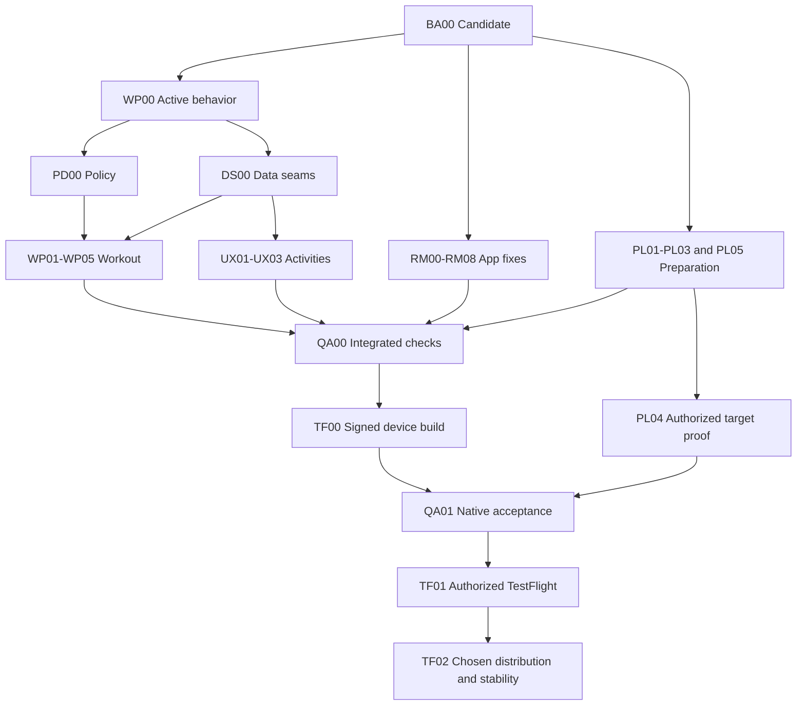

# Full implementation plan: workout correctness and TestFlight beta

Prepared 2026-11-04. **Ready for corrective implementation; application work has not started in this chat.** This plan combines the new workout/activity requirements, the full-app audit, existing UI remediation and outstanding release gates.

## Outcome and inputs

Deliver one integrated iOS candidate with feasible strength-centred generation, research-informed exercise selection, progression from actual performance, a single readiness/cycle decision, pain-safe eligibility, complete Day/All schedules and consistent activity logging/history. Preserve and verify the rest of the app. Qualify compatible database/API/worker releases and a signed physical-device build, then perform only authorized distribution.

Read [audit/matrix](README.md), [workout policy](WORKOUT_POLICY_PROPOSAL.md), [activity experience](ACTIVITY_EXPERIENCE.md), [existing remediation plan](../../design/UI_UX_BACKEND_REMEDIATION_PLAN_2026-11-04.md), root AGENTS/DESIGN/product/safety/architecture and [G0–G9](../../VERIFICATION_GATES.md). The optional [Notion research](https://app.notion.com/p/40f47be9496581ccb0a5f440dd8b1236) is not an execution, approval or recovery dependency.

### Baseline refresh

At planning start Rider was acdb131140dec58c4625132682982b7baba4a4c7 with dirty design/status work. A separate concurrent documentation commit advanced Rider to a2d55adc331dcdcf7d7089d061c9037a1d12e079 during this task, preserving the existing remediation package; this release-audit folder remains untracked. That increment contains documentation only. The latest locally observed origin/main is d840d62745337a604f56f4ba32568fb66ae53158. The coordinator ledger reports P00–P13/R01–R07 complete. R07 removed the unused Infrastructure WorkoutPlanner, IWorkoutPlanner, duration estimator and registration; preserve that cleanup. It did not change workout policy, schedule/logging projection, shared schema lifecycle or the release defects identified here. Core helper reachability still requires proof.

Recheck successors and actual coordinator ownership. Recorded SHAs are reference points, never reset targets. Use the existing CONTROL.md in the actual execution worktree; do not overwrite it with a stale copy or start another authority.

## Confirmed requirements

| ID | Requirement | Required result |
| --- | --- | --- |
| FR01 | Steady progression; studies guide exercise selection rather than favorites | Actual completed work drives next recommendations; no guaranteed weight increase each session. |
| FR02 | Every main muscle at least twice weekly, preferably three times | Explicit meaningful planned/completed exposure and direct/indirect coverage; honest infeasibility. |
| FR03 | Short sessions use high effort and lower volume | Feasible work/rest/setup budget and useful coverage; no compulsory maximal loading/failure. |
| FR04 | Readiness adjusts picked weight | One explained load decision; unknown/stale input cannot manufacture readiness. |
| FR05 | Cycle changes toward lighter load, more reps and more sets | Review the combined demand. Conditional additional sets remain a proposed safeguard, not an accepted user preference. |
| FR06 | Avoid pain-provoking exercises | Hard eligibility, reviewed alternatives or withholding; preserve tri-state/provenance/clearance. |
| FR07 | Strength precedes cardio on combined dates; cardio-only allowed | Consistent prospective order, truthful actual history. |
| FR08 | Day and All, multiple sessions per date | All ordered sessions, stable IDs, independent states and correct local dates. |
| FR09 | Consistent activity logging and history | Shared journey, relevant fields/units, retained drafts, actual saved/read-back/corrected work; duration-only valid. |
| FR10 | One coherent app style and appropriate imagery | Impeccable Operate/Design Taste within current Soft Minimal, shared frame, two buttons/cards, EN/RU/accessibility. |
| FR11 | Preserve existing app capabilities and data | Auth/onboarding, nutrition, hydration, measurements, cycle/media/history/account journeys have explicit acceptance/disposition. |
| FR12 | Real TestFlight readiness | Compatible DB/API/worker/mobile, target isolation/recovery, signed physical acceptance and candidate-bound release authority. |

Do not ask again about settled preferences. Routine technical decisions can use existing reviewed defaults. Consequential unresolved prescribing choices need the concrete PD00 packet below; independent implementation continues while a particular decision waits.

## Team and evidence model

One integration authority coordinates Product A, Platform B and an independent reviewer. A.UI/A.API are bounded Product A sublanes. A four-slot runtime fits coordinator+A+B+reviewer; sequence smaller specialists when full.

Integration owns root/canonical docs, design authority, shared DTOs/project graph, migrations and release manifests unless exclusively reserved. Workers receive exact base, actual worktree, owned/excluded files, dependencies, fixtures/checks and handoff path. Worktrees do not prove credential isolation. Serialize shared file/schema work.

Use the existing CONTROL record and evidence conventions. Track Implemented / Locally verified / Target verified / Accepted separately from merged status. Gate states remain PASS/FAIL/BLOCKED/NOT VERIFIED/N/A. Record source/tree, artifact/config/schema identity, commands/results, reviewer findings, compatibility/recovery limits and next action without health payloads, secrets or private media.

## Canonical package map

This table owns the IDs. PD00 is policy adoption; WP01–WP05 retain their meanings in the policy proposal. Subpackages a/b split capture/projection from behavior/UI. RM00–RM08 keep their original definitions. PL packages correct acceptance gaps without rerunning P00–P13 history.

| Package | Lead | Dependencies | Deliverable / exit |
| --- | --- | --- | --- |
| BA00 Baseline/bootstrap | Integration | None | Candidate/source map, selected planning inputs available to workers, complete capability/issue inventory, ownership, authorization and reopened gates. |
| WP00 Active-path characterization | Product A | BA00 | Production caller/state map; deterministic current success/limited/input/conflict/failure cases; generation vs transport vs native crash separated. |
| PD00 Policy adoption packet | Integration + A | WP00 | Concrete versioned before/after parameters, sources/uncertainty and examples; unresolved consequential choices explicitly disposed. |
| DS00 Compatible data seams | Integration; A/B contribute | WP00; PD00 for policy-specific fields | Minimal additive contract/persistence design for actual sets/activity metrics, all-session schedule and prescription/version provenance; old-client strategy and migration request. |
| WP02a Catalog inventory/identity | Product A | BA00 | Exact supported variation/equipment/region metadata and existing evidence, gaps and versioning. |
| WP02b Evidence selection | Product A | PD00, WP02a | Reviewed shortlist/ranking after hard safety/equipment filters; uncertainty and equivalent options retained. |
| WP01 Coverage/time/scheduling | Product A | PD00, DS00, WP02a; WP02b for final ranking | Every main muscle evaluated; preferred third exposure; same weekly dose distributed appropriately; explicit limited/withheld outcomes and persisted order. |
| WP03a Observed performance | Product A | DS00; PD00 data requirements | Planned/actual set records, comparable load vocabulary, effort Unknown, correction and temporary-adjustment provenance round-trip. |
| WP03b Progression execution | Product A | PD00, WP03a, WP02a | Actual work reaches active next-prescription route; increase/hold/reduce/recovery and explanations verified. |
| WP04 Readiness/cycle | Product A | PD00, WP03a; WP03b integration | One final session load/reps/sets/effort, baseline retained, no stacked modifiers, genuine policy review/gating. |
| WP05 Pain/restrictions | Product A | DS00, WP02a; PD00 for changed policy; WP02b for new evidence-ranked alternatives | Structured provoking-movement report, reviewed alternative/withhold, provenance/clearance and accepted-plan safety. |
| UX01a Complete day contract | Integration + A.API | DS00 | Every ordered session survives projection/DTO/mapper/state with compatible legacy fields. |
| UX01b Day/All surface | Product A.UI | UX01a; WP01 for final schedule | Date-grouped lists, real day scope, independent activity state/action and return context. |
| UX02a Activity-level actuals | Product A.API | DS00, UX01a | Zero-exercise activities support appropriate metrics without fabricated strength rows; units and duration-only valid. |
| UX02b Shared logger | Product A.UI | UX02a, WP03a | Consistent intro/log/resume/save/finish/error/retry for every supported modality. |
| UX03 Media/results/history | Product A.UI | UX01b, UX02b | Accurate imagery/fallback, relevant summaries and equivalent historical correction/read-back. |
| RM00–RM08 Existing remediation | Existing leads | BA00 + original dependencies | CR01/PG01, photo/archive, nutrition scrolling/editing/micronutrients, F01–F03, accessibility/frame and intended missing journeys. |
| PL01 Endpoint/account isolation | B + A consumer seam | BA00 | Fail-closed Release target, environment-bound auth/cache/media and safe legacy-token migration; compiled identity/contamination negatives. |
| PL02 Schema lifecycle/recovery | B; Integration numbers | BA00; DS00 for app deltas | Explicit adoption, ordered upgrades/checksums/locks/compatibility, real disposable old/new rehearsal and preservation/recovery. |
| PL03 Immutable release tooling | B | BA00; PL02 contract for final acceptance | API+worker manifests/digests/storage verification, correct permissions, real actions/probes and supported GitHub-only operation. |
| PL04 Isolated target qualification | B + Integration | PL01–PL03 + matching target authority; final QA00 candidate for closure | Effective isolation/resources, synthetic successful authenticated product/worker/media flows, performance and recovery. |
| PL05 Privacy/auth/Apple packet | A + B; Integration | BA00; final collection/scope | Accurate policy/App Privacy/manifest/entitlements/AASA/deletion/auth; publication separately controlled. |
| QA00 Integrated acceptance | Integration + reviewer | WP/UX/RM code and PL01–PL03/PL05 source checks locally verified | Full app/API/persistence/worker/security/compatibility matrix on one candidate, required local blockers closed; target acceptance remains PL04. |
| TF00 Signed device candidate | Integration + A | QA00, PL01, PL05 + native/signing authority | Signed ios-arm64 package with source/endpoint/SDK/signing/privacy provenance and digest. |
| QA01 Native/device acceptance | A + owner/reviewer | QA00, TF00; PL04 for deployed cases | Physical iPhone functional/design/accessibility/crash evidence on exact binary; simulator gaps labelled. |
| TF01 Internal TestFlight | Integration + owner | QA01, PL04, TF00 + concrete release approval | Processing, internal install/smoke/feedback verified and release/recovery identity recorded. |
| TF02 External/stability closeout | Integration + owner | TF01 + distribution decision | External review/install if requested; agreed observation/support/metrics and final acceptance. |

Local code/tooling can progress before external authority. A package ID never grants schema, cloud, physical-device or distribution permission. Partial fixture-driven UI checks cannot close deployed/native evidence.

The table is authoritative; the diagram abbreviates dependencies.

## First execution checkpoint: BA00 and WP00

Read the documents by their absolute Rider path. They are uncommitted and will not appear in a fresh worktree automatically. Compare/import only the selected planning package and required existing remediation inputs under the coordinator's reservation; never copy Rider wholesale, its dirty root status files or private screenshots. Provide a reviewed tracked snapshot before remote workers start. Local reading requires no commit.

Inventory intended capability → entry point → API/store → result/history → actual acceptance. Preserve health sync as dormant, fasting/new platforms as excluded and existing history/data. Measurements, hydration and history cannot disappear under a “minimal beta” label. Reconcile every old P/R/RM status with current evidence.

First checkpoint: exact candidate/source drift, existing owners/reservations, authorization, reopened findings, ready parallel assignments and the PD00 packet to prepare. Then continue implementation; do not stop after another broad audit. WP00, typed failure/crash fixtures, catalog inventory, endpoint/release source work and disjoint RM fixes can proceed independently.

## PD00: concrete decisions without blocking unrelated work

Prepare one concise packet containing:

1. The settled FR requirements, including cardio-only days and requested cycle extra sets.
2. Proposed muscle/region taxonomy, meaningful exposure and direct/indirect accounting; at most one counted exposure per muscle/local date; planned versus completed coverage.
3. Exact proposed sets/rep/effort/rest, time estimate, progression exposure/equipment increment, readiness calibration and cycle bounds. Label each evidence-supported, product heuristic, preference or unresolved.
4. One precedence table: restrictions/safety → current symptoms/observed performance → current readiness → established individual cycle response → calendar estimate. One owner returns the final dose.
5. Cycle-mode examples when extra sets fit, and the symptomatic/low-readiness conflict. Do not silently turn the request into fewer sets; recommend the safeguard explicitly.
6. Authentic policy version/scope/reviewer/owner/date/limitations. Product adoption is not clinical validation; no fixture-based sign-off.
7. Six before/after synthetic examples: normal progression, partial log, short-session infeasibility, low readiness, cycle mode plus fatigue, and pain with no eligible alternative.

Only affected new prescribing behavior waits on unresolved material decisions. Continue compatible optional/Unknown data contracts, gated alternatives, diagnostics, UI and platform work. The coordinator can make routine technical choices within existing reviewed defaults; do not turn PD00 into a repeated questionnaire.

## Implementation contracts and acceptance

### Active path, coverage and evidence selection

Characterize the real proposal → preview/Apply → persisted schedule → session → actual logs → next recommendation. Preserve typed feasible/limited/required-answer/style-choice/lease/catalog/auth/offline/server/schema outcomes and accepted plans. Fake responses isolate native crash/recovery from generation. No local fallback or safety relaxation conceals failures.

Prove helper reachability and equivalence before connecting/retiring anything. R07's separate Infrastructure cleanup does not establish progression. Use evidence for exact exercise variations and measured growth after eligibility; never an EMG/favorites leaderboard, universal lengthened-position winner or unvalidated decimal science score. Preserve equivalent options and progression stability.

Evaluate every adopted main muscle/region. A third weekly exposure redistributes reviewed volume rather than multiplying it. Multiple Tuesday sessions count as one exposure day. Include warm-up, rest, setup and transitions in real time budgets; report uncovered muscles/constraints and safe choices when minimums cannot fit. Preserve strength→cardio→recovery ordering and cardio-only days.

### Data identity, logging and progression

DS00/WP03a must define immutable baseline, temporary session prescription, observed work and policy/input provenance. Represent variation/equipment/ROM context; external versus per-hand/total load; unilateral/bodyweight/assistance and increments. Distinguish warm-up/optional/partial/skipped/aborted/completed work and effort Unknown. A default true does not verify technique.

Capture complete evidence before progression decisions. Validate completeness, duplication, order, comparable loads and available increments. Corrections recompute eligible future suggestions without changing historical actuals or silently rewriting accepted plans. Do not expand aggregate legacy logs into invented sets or punish a missed calendar week as failed work. Test two-device writes, log corrections, exercise swaps and return after a break.

### Readiness, cycle and pain

One composed policy returns session load, reps, sets, effort, reason/confidence/freshness/version and acceptance requirement. Preserve baseline and prevent retry/start/resume/worker paths applying adjustments twice. A readiness score is not a weight percentage. An estimated phase is not hormone measurement.

Implement adopted numbers only. No fixture approval, unsupported phase PRs or hidden increase in demand from independent load/reps/sets rules. Conditional extra cycle sets remain a recommendation until explicitly disposed. Recovery loads retain temporary context instead of becoming unexplained permanent regression.

Pain reports stop the provoking movement, re-evaluate reviewed alternatives and retain causal restrictions/acknowledgments/clearance. Generic same-muscle substitutions cannot bypass a trigger. No safe strength remainder yields an explicit limitation/withhold, not relabelled rehabilitation. Preserve first-plan tested acceptance and explicit replacement Apply/idempotency.

### Day/All and every activity

Use a complete ordered sessions collection with additive old-client compatibility; primary/companion may remain only a transitional projection. Day scopes the list; All groups dates. Preserve selected date and session state on return and model account-local dates/time zone/DST/cross-midnight sessions.

Canonical no-exercise running/cycling/recovery needs activity-level logging, not fake strength rows. Explicit modality/capabilities replace English-name matching. Running duration/distance/pace, swimming meters/100m conversions, supported optional cycling metrics and duration-only logs have one conversion seam and precise edits. No fabricated sensors/GPS/HealthKit.

Intro/logger/footer/save/resume/finish/retry/history share anatomy and state semantics. Failed or lost saves retain drafts and truthful pending/completed status. Summaries are modality-relevant, without weight-volume PRs on cardio. Historical corrections read back the actual edited record/date.

Apply Impeccable and Design Taste within MAUI Soft Minimal: shared frame/header/modal lifecycle, two buttons/cards, existing fonts/palette/Shell, EN/RU and accessible native tasks. Inventory exact media/rights before promising assets; use stable localized modality fallbacks. No private photo reuse or unreviewed technique illustrations. Browser inspection cannot certify native screens.

### Preserve the RM queue and all app capabilities

CR01/native layout/lifetime and PG01/typed generation recovery remain separate. Begin diagnostics early. RM02 handles photo/archive, RM03 meal scrolling, RM04 locale/precision/date edits, RM05 truthful selected-date micronutrients, RM06 injury/hydration/cycle/accessibility, RM07 shared frame and intended measurements/reschedule/notes/hydration journeys. Preserve the original issue acceptance. RM08 feeds QA00/QA01, not another control ledger.

Serialize FoodLog root, shared modal sizing/lifetime, localization, composition/project files, DTOs/schema and mapper partials. Prefer bounded vertical slices over a large UI rewrite.

### Correct the platform and Apple gates

PL01 fails closed on absent/invalid Release targets and binds actual endpoint/auth/cache/media identity. Legacy shared tokens need provenance-aware migration or safe reauthentication, never import into every environment. Verify Debug overrides and the compiled binary.

PL02 establishes existing-schema adoption and ordered shared upgrades/checksums/locks with fresh/previous/current schemas and supported client/worker compatibility. Rehearse repeat/partial execution, contention, mismatch, integrity and restore/forward-fix on disposable PostgreSQL. No runtime migrations, dbinit drift repair, blind fingerprints or tester-data cleanup.

PL03 joins API+worker immutable digests, storage version, config and schema compatibility. Correct permission/verification mismatches. Replace echoed success with real target actions/probes and select the qualified artifact for promotion rather than rebuilding Beta. Prove supported GitHub-only operation without deleting legitimate history.

PL04 reads exact target/account/resource identity and effective permissions before changes. Verify DB/API/compute/worker/queues/buckets/secrets isolation and cross-environment denies. Provisioning/IAM/deployment needs concrete approval. Synthetic qualification covers authenticated successful generation/Apply/logging, media/reconciliation/deletion, bounded concurrency/performance and recovery. Liveness alone is insufficient. Isolation/preparation can begin early, but final target qualification must match the QA00 candidate; subsequent source/artifact/config/schema changes reopen affected target checks.

PL05 reconciles actual collection/providers/retention with privacy/App Privacy, required API reasons, AASA, Apple auth/deletion/revocation and dormant capabilities. Inspect packaged manifest/entitlements. Prepare concrete source/content/config changes before any publication approval; invent no privacy facts or guaranteed Apple rejection.

## Verification and release closure

Discover candidate test commands/projects; run affected checks first, then integrated tests when code converges. Tests must exercise behavior/persistence/failure boundaries, not just source strings. Historical counts remain historical.

| Family | Explicit cases |
| --- | --- |
| GEN | Every supported goal/day/equipment/time profile; all muscles; same dose across 2/3 exposures; infeasible constraints; safe remainder; deterministic input/catalog versions. |
| PROG | Complete/partial/missing actuals; unknown effort; comparable loads; return/swap/correction; duplicates/out-of-order/two-device writes; temporary recovery; production next-prescription proof. |
| ADAPT/INJ | Current/missing/stale/contradictory readiness/cycle; composition once; extra-set conflict; tri-state restriction, permitted/blocked/conditional alternatives, no safe remainder and clearance lineage. |
| ACCEPT | First-plan exception; replacement decline/Apply; acknowledgment, lease/takeover, stale preview, repeat/lost response and recovery after acceptance. |
| ACT | Third/fourth activity survives acceptance→Day/All→start→finish→history; real accepted Running opens metric logger; units, duration-only and relevant corrected summaries. |
| CORE | Auth/onboarding; nutrition/search/edit/copy/date/coverage; hydration/measurements; cycle freshness; privacy/media/archive/deletion and complete capability ledger. |
| REL | Offline/restart/background; account/environment change; cancellation; retained drafts; ownership/redaction; stale/double save and compatibility. |
| PERF | Successful feasible/complex/restricted generation and Apply/logging, cold/warm, workload/concurrency/window, latency/errors/timeouts and worker backlog. Budgets agreed before acceptance. |
| DB/OPS | Disposable adoption/upgrade/integrity/locks; old/new client/API/worker; exact artifact/config/target; isolation and tested restore/rollback/forward-fix limits. |
| NATIVE | Exact failing/fixed binary; normal/rapid retry/edit/back; all modalities; EN/RU, light/dark, largest text, VoiceOver/Reduce Motion, keyboard/safe areas/scroll/gesture/background/network. |

QA00/QA01 use one integrated candidate and explicit schema/config/backend contract. Record device/iOS/build/digest/endpoint/account type and actual flow outcomes. Simulator evidence never replaces physical installation. Unavailable authority/tooling/target is BLOCKED or NOT VERIFIED.

Release gates: adopted policy and complete capabilities → passing integrated checks → rehearsed DB compatibility/recovery → qualified immutable API+worker target → inspected signed ios-arm64 candidate → physical acceptance/privacy/auth → candidate-bound owner go/no-go → authorized upload/processing/internal install → external review/observation if chosen.

Each protected packet names source/tree/artifacts/schema/config, exact account/resource/target, permission/change impact, passed/unrun gates, lock, preservation/recovery limits and measured postconditions. Serialize environment mutations; on partial failure stop dependent work and preserve evidence. Code rollback does not promise data reversal.

Finish with current policy/candidate, capability/issue status, tests/target/device evidence, supported clients, measured performance/recovery, distribution identity, known limitations and exact next action. “Merged” and “released” remain distinct.

## Start

Follow [START_HERE.md](START_HERE.md) and [ORCHESTRATOR_PROMPT.md](ORCHESTRATOR_PROMPT.md). This request prepares artifacts only. Explicitly invoking the execution message supplies its bounded future local-work scope; protected actions retain matching authority. No application work, message to another owner chat, commit/push or release started merely by creating this plan.

