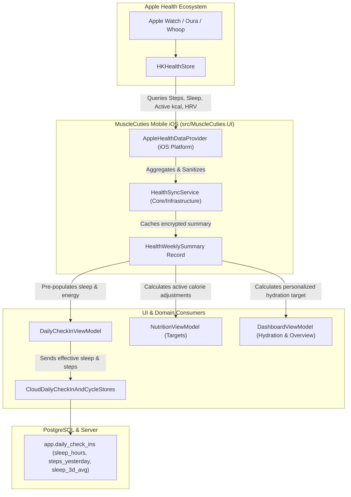

# Detailed Implementation Plan: HealthKit Integration & TestFlight Delivery

**Date:** 2026-11-09 / 2026-11-10  
**Status:** Approved for Implementation (Owner Scope Authorized)  
**Target Platform:** iOS 18.0+ / iOS 26.3 (`net10.0-ios`), iPhone 17  
**App ID:** `com.musclecuties.app`

---

## Executive Summary

Per owner authorization, HealthKit synchronization is being activated from its previous dormant state. The app will interface with Apple HealthKit to read:
1. **Movement / Activity**: Daily and weekly step counts (`HKQuantityTypeIdentifier.StepCount`) and active calories burned (`HKQuantityTypeIdentifier.ActiveEnergyBurned`).
2. **Sleep Duration & Stages**: Last night's sleep duration and 7-day average sleep (`HKCategoryTypeIdentifier.SleepAnalysis`).
3. **Restoration / Recovery Metrics**: Resting heart rate (`HKQuantityTypeIdentifier.RestingHeartRate`) and Heart Rate Variability (`HKQuantityTypeIdentifier.HeartRateVariabilitySDNN`) from Apple Watch, Oura, or Whoop.

These metrics directly:
- **Pre-populate the Daily Check-In**: Automatically initialize sleep hours and suggest recovery/energy levels while preserving trainee control.
- **Adjust Daily Caloric Targets**: Dynamically offset daily energy needs based on real activity via [`HealthEnergyAdjustment`](file:///Users/denispetruk/RiderProjects/MuscleCuties/.agent-worktrees/qa-20261109/src/MuscleCuties.Infrastructure/Services/Health/HealthEnergyAdjustment.cs).
- **Prepare the Binary for TestFlight Distribution**: Configured with proper iOS entitlements, privacy declarations, and signing settings.

---

## Architecture Diagram



---

## Work Packages Breakdown

### WP-HK1: iOS Entitlements, Capabilities & Privacy Manifest
- **Files to Modify:**
  - [`src/MuscleCuties.UI/Platforms/iOS/Entitlements.plist`](file:///Users/denispetruk/RiderProjects/MuscleCuties/.agent-worktrees/qa-20261109/src/MuscleCuties.UI/Platforms/iOS/Entitlements.plist)
  - [`src/MuscleCuties.UI/Platforms/iOS/Info.plist`](file:///Users/denispetruk/RiderProjects/MuscleCuties/.agent-worktrees/qa-20261109/src/MuscleCuties.UI/Platforms/iOS/Info.plist)
  - [`src/MuscleCuties.UI/Platforms/iOS/Resources/PrivacyInfo.xcprivacy`](file:///Users/denispetruk/RiderProjects/MuscleCuties/.agent-worktrees/qa-20261109/src/MuscleCuties.UI/Platforms/iOS/Resources/PrivacyInfo.xcprivacy)
  - [`src/MuscleCuties.UI/MuscleCuties.UI.csproj`](file:///Users/denispetruk/RiderProjects/MuscleCuties/.agent-worktrees/qa-20261109/src/MuscleCuties.UI/MuscleCuties.UI.csproj)
- **Detailed Tasks:**
  1. Add `com.apple.developer.healthkit` and `com.apple.developer.healthkit.access` to `Entitlements.plist`.
  2. Add `NSHealthShareUsageDescription` and `NSHealthUpdateUsageDescription` to `Info.plist` with clear, Apple-compliant user rationale:
     - *"MuscleCuties reads your steps, active energy, sleep, and heart metrics from Apple Health to pre-populate your daily check-in and customize your daily nutrition targets."*
  3. Ensure `PrivacyInfo.xcprivacy` declares `NSPrivacyCollectedDataTypeHealth` and `NSPrivacyCollectedDataTypeFitness` under `NSPrivacyCollectedDataTypePurposeAppFunctionality`.
  4. Update `.csproj` to link HealthKit frameworks when targeting iOS.

---

### WP-HK2: Multi-Metric `AppleHealthDataProvider` Implementation
- **File to Create:**
  - `src/MuscleCuties.UI/Platforms/iOS/AppleHealthDataProvider.cs`
- **Interfaces Implemented:**
  - `IHealthDataProvider`, `IHealthAuthorizationProvider`, `IHealthDataProviderDiagnostics`, `IDisposable`
- **Detailed Tasks:**
  1. **Authorization Request:**
     - Request read authorization for:
       - `HKQuantityTypeIdentifier.StepCount`
       - `HKQuantityTypeIdentifier.ActiveEnergyBurned`
       - `HKQuantityTypeIdentifier.RestingHeartRate`
       - `HKQuantityTypeIdentifier.HeartRateVariabilitySDNN`
       - `HKCategoryTypeIdentifier.SleepAnalysis`
  2. **Step Count Queries:**
     - Query cumulative steps for past 7 days (calculating average daily steps).
     - Query yesterday's step count (`start = today - 1d`, `end = today`).
  3. **Sleep Duration Queries:**
     - Query `HKCategoryValueSleepAnalysis.AsleepCore`, `AsleepDeep`, and `AsleepREM` samples for the previous night (6:00 PM yesterday to 12:00 PM today).
     - Sum total duration in hours (`LastNightSleepHours`).
     - Query 7-day average sleep duration (`AverageSleepHours` and `AverageSleep3dHours`).
  4. **Restoration & Recovery Queries:**
     - Query the most recent `RestingHeartRate` reading within the last 24 hours.
     - Query the most recent `HeartRateVariabilitySDNN` within the last 24 hours.
     - Calculate a composite restoration indicator (or store raw HRV/RHR in [`HealthWeeklySummary`](file:///Users/denispetruk/RiderProjects/MuscleCuties/.agent-worktrees/qa-20261109/src/MuscleCuties.Infrastructure/Services/Health/HealthWeeklySummary.cs)).
  5. **Active Energy Query:**
     - Query `ActiveEnergyBurned` cumulative sum over 7 days to derive `AverageActiveEnergyKcal`.

---

### WP-HK3: Platform Composition & Dependency Injection
- **Files to Modify:**
  - [`src/MuscleCuties.UI/Composition/PlatformCompositionExtensions.cs`](file:///Users/denispetruk/RiderProjects/MuscleCuties/.agent-worktrees/qa-20261109/src/MuscleCuties.UI/Composition/PlatformCompositionExtensions.cs)
- **Detailed Tasks:**
  1. On iOS (`#if IOS`), register `AppleHealthDataProvider` as both `IHealthDataProvider` and `IHealthAuthorizationProvider`.
  2. Replace `services.AddSingleton<IHealthSyncService, DisabledHealthSyncService>()` with:
     ```csharp
     #if IOS
     services.AddSingleton<AppleHealthDataProvider>();
     services.AddSingleton<IHealthDataProvider>(sp => sp.GetRequiredService<AppleHealthDataProvider>());
     services.AddSingleton<IHealthSyncService, HealthSyncService>();
     #else
     services.AddSingleton<IHealthSyncService, DisabledHealthSyncService>();
     #endif
     ```
  3. Ensure app runs seamlessly in the iOS simulator even when HealthKit has 0 samples or is simulated.

---

### WP-HK4: Daily Check-In UI Pre-Population
- **Files to Modify:**
  - [`src/MuscleCuties.UI/ViewModels/Dashboard/DailyCheckInViewModel.cs`](file:///Users/denispetruk/RiderProjects/MuscleCuties/.agent-worktrees/qa-20261109/src/MuscleCuties.UI/ViewModels/Dashboard/DailyCheckInViewModel.cs)
  - [`src/MuscleCuties.UI/Controls/Dashboard/DailyCheckInContent.xaml`](file:///Users/denispetruk/RiderProjects/MuscleCuties/.agent-worktrees/qa-20261109/src/MuscleCuties.UI/Controls/Dashboard/DailyCheckInContent.xaml)
  - [`src/MuscleCuties.UI/Services/Localization/UiTextCatalog.Dashboard.cs`](file:///Users/denispetruk/RiderProjects/MuscleCuties/.agent-worktrees/qa-20261109/src/MuscleCuties.UI/Services/Localization/UiTextCatalog.Dashboard.cs)
- **Detailed Tasks:**
  1. Inject `IHealthSyncService` into `DailyCheckInViewModel`.
  2. When the check-in modal loads (`CheckIfAlreadyCompletedAsync`):
     - If check-in is not already completed and `healthSummary.LastNightSleepHours` > 0:
       - Set `SleepHours = Math.Clamp(summary.LastNightSleepHours.Value, 0.0, 16.0)`.
       - Mark `_isSleepHoursAnswered = true`.
       - Display a badge: *"Auto-filled from Apple Health (X.X hrs)"*.
     - If resting heart rate / HRV indicates high or low recovery:
       - Pre-select or suggest `EnergyLevel` (1–5) and `PlanningSleepQuality` (1–5).
  3. The trainee can freely adjust any slider or toggle; explicit edits override the pre-filled values.

---

### WP-HK5: Caloric Target & Activity Integration
- **Files to Modify:**
  - [`src/MuscleCuties.UI/ViewModels/Nutrition/NutritionViewModel.cs`](file:///Users/denispetruk/RiderProjects/MuscleCuties/.agent-worktrees/qa-20261109/src/MuscleCuties.UI/ViewModels/Nutrition/NutritionViewModel.cs)
  - [`src/MuscleCuties.UI/ViewModels/Nutrition/NutritionViewModel.Targets.cs`](file:///Users/denispetruk/RiderProjects/MuscleCuties/.agent-worktrees/qa-20261109/src/MuscleCuties.UI/ViewModels/Nutrition/NutritionViewModel.Targets.cs)
  - [`src/MuscleCuties.Infrastructure/Services/Health/HealthEnergyAdjustment.cs`](file:///Users/denispetruk/RiderProjects/MuscleCuties/.agent-worktrees/qa-20261109/src/MuscleCuties.Infrastructure/Services/Health/HealthEnergyAdjustment.cs)
- **Detailed Tasks:**
  1. Retrieve cached `HealthWeeklySummary` during nutrition overview load.
  2. Compute activity adjustment via `HealthEnergyAdjustment.CalculateDailyCalories(summary, weightKg, age, daysPerWeek, phase)`.
  3. Surface the adjustment in the nutrition breakdown card (e.g., `+180 kcal Activity adjustment from Apple Health steps`).
  4. Keep the calculation deterministic, safe, and clamped within approved safety ranges (max +260 kcal / -180 kcal).

---

### WP-HK6: Verification & Test Coverage
- **Files to Add / Modify:**
  - `tests/MuscleCuties.Core.Tests/AppleHealthSyncIntegrationTests.cs`
  - `tests/MuscleCuties.Core.Tests/HealthStepSyncTests.cs`
- **Detailed Tasks:**
  1. Unit tests covering:
     - `HealthWeeklySummary` parsing with complete vs. partial metrics (e.g. steps only, sleep only, no HRV).
     - `HealthEnergyAdjustment` calculation matrix across weights, ages, and cycle phases.
     - `DailyCheckInViewModel` pre-population logic when HealthKit summary is present vs. null.
  2. Full solution compile check (`net10.0-ios`).
  3. Maestro automated flow on simulator checking that check-in handles HealthKit data gracefully without crashing or regressions.

---

## Owner Ratified Decisions (2026-11-09)

1. **Permission Prompt Timing (A):** Contextual prompt — the app requests Apple Health access when the trainee opens their first Daily Check-In or visits Profile sync settings (not during cold onboarding).
2. **Calorie Adjustment Model (A):** Rolling 7-day average step trend against baseline via `HealthEnergyAdjustment` (smooth, deterministic, avoiding volatile daily macro swings).
3. **Check-in Pre-fill Behavior (A):** Auto-fill **Sleep Hours** directly from HealthKit; provide a **"Suggest from Apple Health"** chip for energy and sleep quality sliders so the trainee explicitly confirms or adjusts subjective recovery.

---

## Subagent Orchestration & Work Package Assignments

To execute rapidly and safely across isolated change boundaries:

### Subagent 1: HealthKit Platform Specialist (WP-HK1 & WP-HK2)
- **Role:** iOS Platform & Native HealthKit Developer
- **Scope & Files:**
  - `src/MuscleCuties.UI/Platforms/iOS/Entitlements.plist` (add `com.apple.developer.healthkit` & access).
  - `src/MuscleCuties.UI/Platforms/iOS/Info.plist` (add `NSHealthShareUsageDescription` & `NSHealthUpdateUsageDescription`).
  - `src/MuscleCuties.UI/Platforms/iOS/Resources/PrivacyInfo.xcprivacy` (declare health/fitness data usage).
  - `src/MuscleCuties.UI/Platforms/iOS/AppleHealthDataProvider.cs` (multi-metric query implementation: `StepCount`, `ActiveEnergyBurned`, `SleepAnalysis`, `RestingHeartRate`, `HeartRateVariabilitySDNN`).
- **Outcome:** Complete, compilable `AppleHealthDataProvider` conforming to `IHealthDataProvider` and `IHealthAuthorizationProvider`.

### Subagent 2: Composition & Calorie Integration Specialist (WP-HK3 & WP-HK5)
- **Role:** Infrastructure & Domain Integration Developer
- **Scope & Files:**
  - `src/MuscleCuties.UI/Composition/PlatformCompositionExtensions.cs` (register `AppleHealthDataProvider` on iOS, replace `DisabledHealthSyncService` with real `HealthSyncService`).
  - `src/MuscleCuties.UI/ViewModels/Nutrition/NutritionViewModel.Targets.cs` & `NutritionViewModel.cs` (integrate `HealthEnergyAdjustment.CalculateDailyCalories(summary, ...)` into displayed daily calorie breakdown).
- **Outcome:** Health sync active in runtime DI; daily nutrition target cleanly reflects step-trend calorie adjustments.

### Subagent 3: Check-In & UI Experience Specialist (WP-HK4)
- **Role:** Mobile UI & Check-In Workflow Developer
- **Scope & Files:**
  - `src/MuscleCuties.UI/ViewModels/Dashboard/DailyCheckInViewModel.cs` (inject `IHealthSyncService`, auto-fill `SleepHours` when available, add `SuggestFromAppleHealthCommand` and suggestion state).
  - `src/MuscleCuties.UI/Controls/Dashboard/DailyCheckInContent.xaml` & `xaml.cs` (add visual "From Apple Health" chip and suggestion button).
  - `src/MuscleCuties.UI/Services/Localization/UiTextCatalog.Dashboard.cs` & `RussianUiText.Dashboard.cs` (EN/RU copy for HealthKit suggestions).
- **Outcome:** Trainees see their real sleep pre-filled and can one-tap apply recovery suggestions.

### Subagent 4: QA & Release Specialist (WP-HK6)
- **Role:** Test & Verification Specialist
- **Scope & Files:**
  - `tests/MuscleCuties.Core.Tests/` (unit tests for multi-metric summary aggregation, energy calculation, and check-in pre-fill).
  - `src/MuscleCuties.UI/MuscleCuties.UI.csproj` (bump `<ApplicationVersion>` to `3`).
  - Simulator verification run with Maestro.
- **Outcome:** Clean test run, 0 warnings/errors, validated build ready for TestFlight upload.
