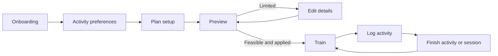

# Workout setup and session flow

Updated 2026-10-25. This is the interaction contract for the path from onboarding through a completed workout.

## Interaction contract

| Stage | Loading and failure | Retry | Close and back | Success |
| --- | --- | --- | --- | --- |
| Onboarding | Keep the current form visible for validation and save errors. Do not advance when saving fails. | Retry the same Continue or quiz-load action; preserve entered answers. | Quiz Back returns to profile setup and preserves the staged profile. | Save profile setup and quiz answers. After authentication, open Activity preferences. If a new account requires login, resume this transition after login. |
| Activity preferences | Block the page with the shared loading/error surface while preferences and the reviewed exercise catalog load. Save failure leaves the page editable and previously saved preferences intact. | Retry reloads preferences and catalog; after success the loading/error surface disappears. Retry Save with the existing action after a save failure. | Back asks whether to discard unsaved edits. Keep editing closes the prompt; Discard returns to the prior screen without writing those edits. | Save selected days, activities, strength-session limit, equipment, and exclusions, then open Plan setup. |
| Plan setup | Use the shared full-page loader for saved preferences and recent history. If loading fails, keep setup blocked until Retry succeeds or Back exits. Preview creation shows progress in the pinned action area. | Retry initial load with the error surface. If preview creation fails, keep the editor open and allow Create preview again. | Close or the first Back while the preview is open returns to the editor with its inputs intact. Back from the editor returns to the screen that opened preferences or plan setup. Changing the strength template clears history estimates and timing that belong to the prior choice. | Show the proposal in the preview sheet; a limited proposal offers Edit details and never offers Apply. |
| Plan preview | Keep preview content scrollable and actions visible. Apply errors stay in the sheet and state that the current plan was not changed. | Retry Apply from the sheet. If Apply succeeded but Train navigation failed, show Open Train and retry navigation without submitting the proposal again. | Close dismisses the sheet to the editor. Back dismisses the sheet first. | Only a persisted, feasible proposal can be applied. On acceptance, invalidate Train data and navigate there. |
| Train | Use the shared page loader. On load failure, cover the page and block stale controls. | Retry the page load; a successful result clears the error surface. | Shell Back returns to the previous app surface. | Show the refreshed saved plan and allow a session to start. |
| Workout log | Keep the session context visible. A session-load error shows Retry; save errors stay with the current exercise so entered values can be corrected or retried. | Retry session loading or repeat the failed save action. | Back moves one level at a time: exercise flow to activity intro, activity intro to day overview, then back to Train. | Finish Activity returns to the day overview. Finish Session returns to Train and refreshes the saved plan. |

## Preference and data rules

- Weekdays are selected in the seven-day calendar card and constrained to 2–7 days.
- Exercise choices remain hidden until the user searches. Results filter as the query changes; selected exclusions stay visible as removable chips.
- Activity preferences have no session or duration picker. The onboarding workout question is the single editable strength-session length control; preferences carry its saved answer into plan setup. Cardio and HIIT durations are calculated by their activity rules.
- Weekly activity allocations are calculated from saved activity choices and available days; the UI does not collect manual per-activity counts.
- There is no daily workout time limit. The schedule uses selected weekdays, activity eligibility, recovery spacing, and compatible session pairing; session duration is displayed as an estimate, not used as a daily cap.
- Plan setup sends its loaded activity choices, available days, saved durations, and automatic allocations with the preview request so the schedule is generated from the decisions the user selected.
- Preview opens as a bounded, scrollable sheet. The weekly schedule stays visible, activity details can expand, and rest days do not appear as activity decisions.
- A failed preference save must not replace saved preferences or the saved plan. A strength-template change clears activity-specific self-reported history and timing before another preview.
- Apply is idempotent from the UI: once a proposal is accepted, a navigation retry cannot submit it a second time.

## Acceptance checks

- Save, leave, and reopen preferences; confirm days, selected activities, duration, equipment, and exclusions reload from saved values.
- Change the strength template after entering history; confirm old history and timing do not carry into the new preview.
- Fail and retry initial preference and plan loads; confirm a successful retry removes the full-page error surface.
- Search with no query, a matching query, and a no-match query; confirm the default list stays hidden and selected chips can be removed.
- Exercise Close and Back from both the editor and preview. Exercise limited Edit details, feasible Apply, Apply failure, and accepted-plan navigation retry.
- Start a synthetic workout, log an activity, finish it, and return to Train; also verify the session Back sequence.
